# OpenFactstore User Guide

The single user guide for OpenFactstore: setup, a first fact with `curl`, every screen of the web UI, the API features, CI/CD, Terraform, the CLI, security and operations. The step-by-step [Getting Started series](./getting-started/01-overview.md) and the [API reference](./API_REFERENCE.md) go deeper.

> **Documentation-as-Code:** The screenshots are generated by the Playwright E2E suite (`npm run test:e2e` in `frontend/`, with the dev server running). The examples are checked against the API on every pull request by `node --test tools/docs-drift/*.test.mjs`, and the Hello World and Getting Started steps run end to end against `docker compose` in CI.

---

## Table of Contents

1. [Introduction](#1-introduction)
2. [Architecture](#2-architecture)
3. [Setup & Installation](#3-setup--installation)
4. [Hello World — Your First Fact](#4-hello-world--your-first-fact)
5. [Navigating the UI](#5-navigating-the-ui)
6. [Dashboard](#6-dashboard)
7. [Managing Flows](#7-managing-flows)
8. [Asserting Compliance](#8-asserting-compliance)
9. [Evidence Vault](#9-evidence-vault)
10. [Environments](#10-environments)
11. [Logical Environments](#11-logical-environments)
12. [Audit Log](#12-audit-log)
13. [Deployment Policies](#13-deployment-policies)
14. [Compliance Frameworks](#14-compliance-frameworks)
15. [Drift Detection](#15-drift-detection)
16. [Search](#16-search)
17. [Attestation Types](#17-attestation-types)
18. [Compliance Posture](#18-compliance-posture)
19. [Snapshot Diff](#19-snapshot-diff)
20. [API Feature Guide](#20-api-feature-guide)
21. [CI/CD Integration](#21-cicd-integration)
22. [Infrastructure as Code — Terraform](#22-infrastructure-as-code--terraform)
23. [CLI Reference](#23-cli-reference)
24. [Security & Data Privacy](#24-security--data-privacy)
25. [Monitoring](#25-monitoring)
26. [Flow Setup Patterns](#26-flow-setup-patterns)
27. [The Fact Lifecycle](#27-the-fact-lifecycle)
28. [Compliance Reporting](#28-compliance-reporting)
29. [Troubleshooting](#29-troubleshooting)

---

## 1. Introduction

OpenFactstore is an open-source **Supply Chain Compliance Fact Store**: a system of record for proving that your software artifacts (container images, binaries) met every required security and quality gate before reaching production. It is built for teams in regulated environments (financial services, healthcare, government) where **evidence of compliance** must be collected, timestamped and queryable on demand for audit, incident response and regulatory reporting.

At its core, OpenFactstore answers one question at deployment time:

> _"Has this artifact digest satisfied every required compliance check for the flow it belongs to?"_

Through the API, the CLI and the web UI you can:

- **Define** delivery processes (Flows) with mandatory quality gates.
- **Record** build records (Trails), the artifacts they produced and the evidence (Attestations) for each gate.
- **Assert** whether a specific container image digest is compliant before deployment.
- **Inspect** evidence files (test reports, scan results, approval decisions) attached to each build.
- **Monitor** deployment environments for drift and policy violations.
- **Search** across all artifacts, trails and attestations.

### Key Concepts

| Concept | Description |
|---------|-------------|
| **Flow** | A named compliance policy defining which attestation types (e.g. `junit`, `snyk`, `trivy`) are required before an artifact may be deployed. Flows belong to an Organisation. |
| **Trail** | A record of one software build, capturing Git metadata (commit SHA, branch, PR number, author). Trails belong to a Flow. |
| **Artifact** | A container image or binary, identified by its SHA-256 digest, associated with a Trail. |
| **Attestation** | Evidence that a requirement was met (test run, scan report, approval decision). Has a status: `PASSED`, `FAILED`, or `PENDING`. |
| **EvidenceFile** | The actual evidence payload (JSON, XML, log file) attached to an Attestation, stored with a cryptographic hash. |
| **Environment** | A named deployment target (e.g. `production`, `staging`). Environments hold snapshots of what artifacts are currently deployed. |
| **Organisation** | A top-level tenant. Flows, users, and integrations are scoped to an Organisation. |

---

## 2. Architecture

OpenFactstore is a **CQRS + Event Sourcing** system built on **Hexagonal Architecture** (Ports and Adapters). The same backend image runs as two services, selected by `FACTSTORE_CQRS_ROLE`:

- The **Command service** (`backend-command`, **:8080**) accepts every write (`POST`, `PUT`, `PATCH`, `DELETE`), validates business rules, stores state in its own PostgreSQL database, appends an immutable domain event to the event log and publishes it to RabbitMQ. It also answers reads, so a client that just wrote can read its own write.
- The **Query service** (`backend-query`, **:8081**) consumes those events, projects them into read models in a separate PostgreSQL database and serves reads. It is read-only: any write sent to it is refused with `405 Method Not Allowed`. Because it is fed from the event bus, it is eventually consistent with the command side.

> **Which writes reach the query service:** today only the v2 command API (`/api/v2/...`) publishes events. Writes through `/api/v1/...` are stored by the command service and served by it, but are not projected to the query service, so read v1 data back from `:8080`. The examples in this guide use v1 and the command service throughout.

You can watch the split work in [Step 6 of the Hello World](#step-6-see-the-cqrs-split).

```
┌──────────────────────────────────────────────────────────────────────┐
│            Clients: web UI (Vue 3 SPA) · CLI · CI pipelines           │
└──────────────┬───────────────────────────────────────┬───────────────┘
   writes (POST/PUT/PATCH/DELETE)                     reads (GET)
┌──────────────▼────────────────────────┐ ┌────────────▼──────────────────┐
│ Command service :8080                 │ │ Query service :8081           │
│ backend-command                       │ │ backend-query                 │
│ FACTSTORE_CQRS_ROLE=command           │ │ FACTSTORE_CQRS_ROLE=query     │
│ REST controllers → command handlers   │ │ RabbitMQ consumer → projector │
│ → JPA repositories + event appender   │ │ REST controllers → read models│
└──────┬──────────────────┬─────────────┘ └────────▲──────────────┬───────┘
       │ JDBC             │ AMQP (domain events)   │              │ JDBC
┌──────▼───────────────┐  │  ┌───────────────────┐ │  ┌───────────▼──────────┐
│ postgres-command     │  └─►│ RabbitMQ :5672    │─┘  │ postgres-query       │
│ :5432 (event log +   │     │ (management       │    │ :5433 (read models)  │
│  write model)        │     │  UI :15672)       │    └──────────────────────┘
└──────────────────────┘     └───────────────────┘
          HashiCorp Vault :8200 signs events and holds data keys for both services
```

Inside each service the Dependency Rule holds: REST controllers (driving adapters) call inbound ports, application services implement them and reach the database only through outbound ports implemented by JPA adapters. See [ADR 0001](./adr/0001-append-only-postgres-event-log.md) for the event log and [DEPLOY.md](../DEPLOY.md) for running the services.

**Tech stack:**
- **Backend:** Kotlin 2.0 · Spring Boot 3.4 · Spring Data JPA · PostgreSQL 16 · Flyway · RabbitMQ · Java 21
- **Frontend:** Vue 3 (Composition API) · TypeScript 5.4 · Vite 5 · Tailwind CSS 3.4 · Pinia · Axios
- **Ops:** Docker Compose · Prometheus · Grafana · HashiCorp Vault

---

## 3. Setup & Installation

### Prerequisites

| Requirement | Version | Notes |
|-------------|---------|-------|
| **Docker & Docker Compose** | Any recent version | Runs the full stack: `docker compose version` |
| **Java** | 21 (Eclipse Temurin recommended) | Only to run the backend from source |
| **Node.js** | 20+ | Only for the frontend dev server |
| `curl` and `jq` | Any | The examples in this guide use both |
| **Terraform** | ≥ 1.6 | Optional, for the `infra/` bootstrap |
| **Go** | ≥ 1.25 | Optional, to build the Terraform provider from source |

### Quick Start with Docker Compose

<!-- docs-e2e:skip -->
```bash
git clone https://github.com/MaximumTrainer/OpenFactstore.git
cd OpenFactstore

# Once: generate the session secret, a bootstrap admin key and the Prometheus scrape key
scripts/bootstrap-env.sh

# Start everything: both PostgreSQL databases, RabbitMQ, Vault, the command and query
# services, Prometheus and Grafana
docker compose up --build
```

`scripts/bootstrap-env.sh` writes a git-ignored `.env` and prints the bootstrap admin key once. Authentication is enforced: every API request must carry `Authorization: Bearer <key>`, or it is refused with `401`. Without the script, each service writes a generated bootstrap key to its log instead, and Prometheus cannot scrape. Use the bootstrap key to create your real admin identity and service-account keys, then revoke it (see [Security & Data Privacy](#24-security--data-privacy) and [docs/api-authorisation.md](./api-authorisation.md)).

| Service | URL |
|---------|-----|
| Command API (writes, and reads) | http://localhost:8080 |
| Query API (reads) | http://localhost:8081 |
| Swagger UI | http://localhost:8080/swagger-ui.html (spec at `/api-docs`; both need a credential, like the API) |
| RabbitMQ management | http://localhost:15672 (guest / guest) |
| Prometheus | http://localhost:9090 |
| Grafana | http://localhost:3000 (admin / `changeme`) |
| HashiCorp Vault | http://localhost:8200 |
| Web UI | http://localhost:8080 (built into the image); http://localhost:5173 with the dev server |

Every API example in this guide uses these variables. Run this from the repository root after `docker compose up`:

<!-- docs-e2e:begin -->
```bash
export BASE_URL=http://localhost:8080     # command service: send every write here
export QUERY_URL=http://localhost:8081    # query service: reads, eventually consistent
export FACTSTORE_TOKEN="$(grep '^SECURITY_BOOTSTRAP_API_KEY=' .env | cut -d= -f2-)"

curl -s "$BASE_URL/api/v1/flows" -H "Authorization: Bearer $FACTSTORE_TOKEN" | jq .
```
<!-- docs-e2e:end -->

### Local Development Setup

**Backend** (one service that does both commands and queries, against one PostgreSQL):

<!-- docs-e2e:skip -->
```bash
# 1. Start PostgreSQL
docker compose up -d postgres-command

# 2. Start the Spring Boot dev server (the dev profile turns authentication off)
cd backend
DB_NAME=factstore_command DB_USERNAME=factstore DB_PASSWORD=factstore \
  ./gradlew bootRun --args='--spring.profiles.active=dev'
# Listening on http://localhost:8080
```

**Frontend:**

<!-- docs-e2e:skip -->
```bash
cd frontend
npm ci
npm run dev
# Listening on http://localhost:5173; /api is proxied to http://localhost:8080
```

### Environment Variables

The backend reads these environment variables at startup. `docker-compose.yml` sets them for both services.

| Variable | Default | Description |
|----------|---------|-------------|
| `FACTSTORE_CQRS_ROLE` | *(unset: both roles)* | `command` or `query`; see [Architecture](#2-architecture) |
| `DB_HOST` | `localhost` | PostgreSQL host |
| `DB_PORT` | `5432` | PostgreSQL port |
| `DB_NAME` | `factstore` | Database name |
| `DB_USERNAME` | *(required)* | Database user |
| `DB_PASSWORD` | *(required)* | Database password |
| `RABBITMQ_HOST` / `RABBITMQ_PORT` | `localhost` / `5672` | Event bus between the command and query services |
| `SECURITY_ENFORCE_AUTH` | `true` | Refuse requests without a valid credential. `false` is for local experiments only |
| `SECURITY_BOOTSTRAP_API_KEY` | *(generated, logged)* | Admin key for first use; written to `.env` by `scripts/bootstrap-env.sh` |
| `SSO_JWT_SECRET` | *(none; set by `scripts/bootstrap-env.sh`)* | Session signing secret, at least 32 bytes. The service refuses to start with authentication enforced and a placeholder secret |
| `VAULT_ENABLED` | `false` | Enable HashiCorp Vault for evidence storage |
| `VAULT_ADDR` | `http://localhost:8200` | Vault address |
| `VAULT_TOKEN` | *(required if enabled)* | Vault root/app token |
| `SCM_ENCRYPTION_KEY` | `default-dev-key-32chars!!!!!!` | AES-256-GCM key for SCM token encryption. **Set to a strong random 32-char value in production.** |
| `GF_SECURITY_ADMIN_PASSWORD` | `changeme` | Grafana admin password |

> 💡 **Pro-tip:** For production, set `DB_PASSWORD`, `VAULT_TOKEN` and the bootstrap keys via a secrets manager. Never commit them.

---

## 4. Hello World — Your First Fact

This tutorial walks through the complete compliance lifecycle for a single build: create a Flow, start a Trail, report an Artifact, record Attestations and assert compliance, all with `curl` and `jq`. CI runs exactly these steps against `docker compose` on every pull request, so they work as written.

It assumes the stack from [Setup & Installation](#3-setup--installation) is running and `BASE_URL` and `FACTSTORE_TOKEN` are exported. Every write goes to the command service (`$BASE_URL`).

<!-- docs-e2e:begin -->

### Step 1: Create a Flow

A Flow defines the attestation types your artifact must satisfy. Keep its `id`:

```bash
FLOW_ID=$(curl -s -X POST "$BASE_URL/api/v1/flows" \
  -H "Authorization: Bearer $FACTSTORE_TOKEN" \
  -H "Content-Type: application/json" \
  -d '{
    "name": "my-service-compliance",
    "description": "Compliance flow for my-service",
    "requiredAttestationTypes": ["junit", "snyk"]
  }' | jq -r .id)
echo "$FLOW_ID"
```

The response is the new flow, for example:

```json
{
  "id": "3fa85f64-5717-4562-b3fc-2c963f66afa6",
  "name": "my-service-compliance",
  "description": "Compliance flow for my-service",
  "requiredAttestationTypes": ["junit", "snyk"],
  "createdAt": "2026-01-01T10:00:00Z"
}
```

### Step 2: Start a Trail

A Trail represents a single build. Attach it to your Flow and record Git metadata:

```bash
TRAIL_ID=$(curl -s -X POST "$BASE_URL/api/v1/trails" \
  -H "Authorization: Bearer $FACTSTORE_TOKEN" \
  -H "Content-Type: application/json" \
  -d "{
    \"flowId\": \"$FLOW_ID\",
    \"gitCommitSha\": \"abc123def456\",
    \"gitBranch\": \"main\",
    \"gitAuthor\": \"alice\",
    \"gitAuthorEmail\": \"alice@example.com\"
  }" | jq -r .id)
echo "$TRAIL_ID"
```

### Step 3: Report an Artifact

Register the container image this build produced, by its SHA-256 digest:

```bash
DIGEST="sha256:e3b0c44298fc1c149afbf4c8996fb92427ae41e4649b934ca495991b7852b855"

curl -s -X POST "$BASE_URL/api/v1/trails/$TRAIL_ID/artifacts" \
  -H "Authorization: Bearer $FACTSTORE_TOKEN" \
  -H "Content-Type: application/json" \
  -d "{
    \"imageName\": \"my-service\",
    \"imageTag\": \"v1.2.3\",
    \"sha256Digest\": \"$DIGEST\",
    \"registry\": \"ghcr.io/my-org\",
    \"reportedBy\": \"alice\"
  }" | jq .
```

### Step 4: Record Attestations

Record that the unit tests passed, then that the security scan passed:

```bash
curl -s -X POST "$BASE_URL/api/v1/trails/$TRAIL_ID/attestations" \
  -H "Authorization: Bearer $FACTSTORE_TOKEN" \
  -H "Content-Type: application/json" \
  -d '{
    "type": "junit",
    "status": "PASSED",
    "details": "All 247 unit tests passed"
  }' | jq .

curl -s -X POST "$BASE_URL/api/v1/trails/$TRAIL_ID/attestations" \
  -H "Authorization: Bearer $FACTSTORE_TOKEN" \
  -H "Content-Type: application/json" \
  -d '{
    "type": "snyk",
    "status": "PASSED",
    "details": "No critical vulnerabilities found"
  }' | jq .
```

### Step 5: Assert Compliance

Ask whether the artifact satisfies every requirement of the Flow. `jq -e` exits non-zero unless the answer is `COMPLIANT`, which makes this line a deployment gate as it stands:

```bash
curl -s -X POST "$BASE_URL/api/v1/assert" \
  -H "Authorization: Bearer $FACTSTORE_TOKEN" \
  -H "Content-Type: application/json" \
  -d "{
    \"flowId\": \"$FLOW_ID\",
    \"sha256Digest\": \"$DIGEST\"
  }" | jq -e '.status == "COMPLIANT"'
```

The full response:

```json
{
  "sha256Digest": "sha256:e3b0c44298fc1c149afbf4c8996fb92427ae41e4649b934ca495991b7852b855",
  "flowId": "3fa85f64-5717-4562-b3fc-2c963f66afa6",
  "trailId": "7b9d1e2f-3a4b-5c6d-7e8f-9a0b1c2d3e4f",
  "status": "COMPLIANT",
  "missingAttestationTypes": [],
  "failedAttestationTypes": [],
  "details": "All required attestations passed"
}
```

If a required attestation is missing or failed, `status` is `NON_COMPLIANT` and `missingAttestationTypes` / `failedAttestationTypes` say which.

### Step 6: See the CQRS split

The steps above used the v1 API on the command service. To see the query service at work, create a flow through the v2 command API on `:8080`, then read it from `:8081` once the event has crossed RabbitMQ (usually well under a second):

```bash
curl -s -X POST "$BASE_URL/api/v2/flows" \
  -H "Authorization: Bearer $FACTSTORE_TOKEN" \
  -H "Content-Type: application/json" \
  -d '{ "name": "cqrs-demo", "description": "Written on :8080, read on :8081" }' | jq .

for attempt in $(seq 1 30); do
  curl -s "$QUERY_URL/api/v2/flows" -H "Authorization: Bearer $FACTSTORE_TOKEN" \
    | jq -e '.[] | select(.name == "cqrs-demo")' > /dev/null && break
  sleep 1
done
curl -s "$QUERY_URL/api/v2/flows" -H "Authorization: Bearer $FACTSTORE_TOKEN" | jq -e '.[] | select(.name == "cqrs-demo")'
```

<!-- docs-e2e:end -->

> 💡 **Pro-tip:** Wire the `POST /api/v1/assert` call into your deployment pipeline as a **deployment gate**: block the deploy unless `status` is `COMPLIANT`. The [Getting Started series](./getting-started/01-overview.md) covers each step in more depth.

---

## 5. Navigating the UI

All pages are reachable from the persistent navigation bar at the top of the screen.

**Key Elements in the NavBar:**

| Link / Section | Destination |
|----------------|-------------|
| **OpenFactstore** (logo) | `/` — Dashboard |
| **Flows** | `/flows` — Flow list |
| **Environments** | `/environments` — Environment list |
| **Drift** | `/drift` — Environment drift detection |
| **Logical Envs** | `/logical-environments` — Logical environment groupings |
| **Search** | `/search` — Global search |
| **Assert** | `/assert` — Compliance assertion form |
| **Evidence** | `/evidence` — Evidence Vault |
| **Vault** | `/vault` — Vault backend browser |
| **Compliance** | `/compliance` — Compliance frameworks |
| **Posture** | `/compliance-posture` — Organisation-wide compliance dashboard |
| **Policies** | `/policies` — Deployment policies |
| **Integrations** | `/integrations` — External integrations (Jira, Confluence, Slack) |
| **Audit** | `/audit` — Audit log |
| **Ledger** | `/ledger` — Immutable event ledger |
| **Alerts** | `/notifications/rules` — Notification alert rules |
| **Attestation Types** | `/attestation-types` — Custom attestation type registry |

---

## 6. Dashboard

**Navigate to:** `/`

The Dashboard provides an at-a-glance summary of your delivery pipeline's compliance health.

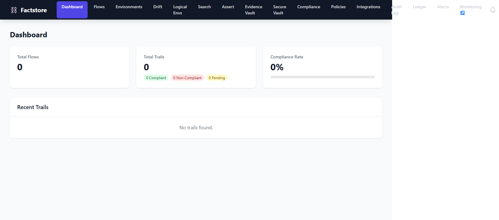

### Key Elements

| Element | Description |
|---------|-------------|
| **Total Flows** card | Count of registered delivery pipelines |
| **Total Trails** card | Count of all build records, with breakdowns for Compliant, Non-Compliant, and Pending |
| **Compliance Rate** card | Percentage of completed builds that are compliant, visualised as a colour-coded progress bar (green ≥ 80%, yellow ≥ 50%, red < 50%) |
| **Recent Trails** table | The 5 most recent trails — shows commit SHA prefix, branch, author, date, and compliance status badge |

### Activity: Reviewing recent build status

1. Navigate to `/`.
2. Scan the **Compliance Rate** card to get an overall health signal.
3. Review the **Recent Trails** list for any `NON_COMPLIANT` or `PENDING` entries.
4. Click any trail row to open its detail view.

---

## 7. Managing Flows

**Navigate to:** `/flows`

A **Flow** represents a repeatable software delivery process. It defines which attestation types (e.g. `junit`, `snyk`, `trivy`) must be present and passing before an artifact may be deployed.

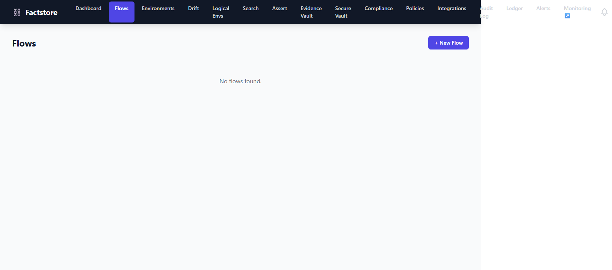

### Key Elements

| Element | Description |
|---------|-------------|
| **+ New Flow** button | Opens the flow creation modal |
| Flows table | Shows name, description, visibility (public/private), required attestation types, tags, and action buttons |
| **Edit** / **Delete** actions | Modify or remove a flow (delete only works when no trails are attached) |

### Activity: Creating a new Flow

1. Navigate to `/flows`.
2. Click **+ New Flow**.
3. Fill in:
   - **Name** — unique identifier for this pipeline (e.g. `payment-service`).
   - **Description** — human-readable summary.
   - **Required Attestation Types** — comma-separated list (e.g. `junit,snyk`).
4. Click **Create**.

> **Tip:** Use the `Visibility` field to mark a Flow as `private` if it should only be visible within your organisation.

### Activity: Viewing Flow details

1. Click a flow's name in the table.
2. The detail view shows all trails for that flow, their compliance status, and the required attestation types.

---

## 8. Asserting Compliance

**Navigate to:** `/assert`

The Assert page lets you ask: _"Is this specific container image compliant with the requirements of a given Flow?"_

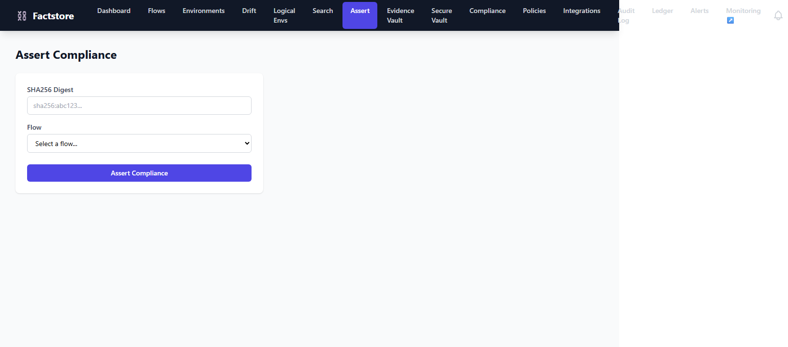

### Key Elements

| Element | Description |
|---------|-------------|
| **SHA256 Digest** field | Accepts a full image digest in the form `sha256:<64-hex-chars>` |
| **Flow** dropdown | Selects the Flow whose requirements to evaluate against |
| **Assert Compliance** button | Submits the assertion |
| Result panel | Shows `✓ COMPLIANT` (green) or `✗ NON_COMPLIANT` (red) with a breakdown of which attestations are satisfied/missing |

### Activity: Asserting before a deployment

1. Navigate to `/assert`.
2. Paste the container image digest (e.g. `sha256:abc123...`) into the **SHA256 Digest** field.
3. Select the relevant **Flow** from the dropdown.
4. Click **Assert Compliance**.
5. Review the result panel:
   - **COMPLIANT** — all required attestation types are present and passing.
   - **NON_COMPLIANT** — one or more required attestation types are missing or failed.

> **Warning:** A `NON_COMPLIANT` result means the artifact should not be deployed until the missing evidence is provided or failures are resolved.

---

## 9. Evidence Vault

**Navigate to:** `/evidence`

The Evidence Vault lists every evidence file that has been attached to an attestation — test XML reports, SARIF scan results, approval documents, and more.

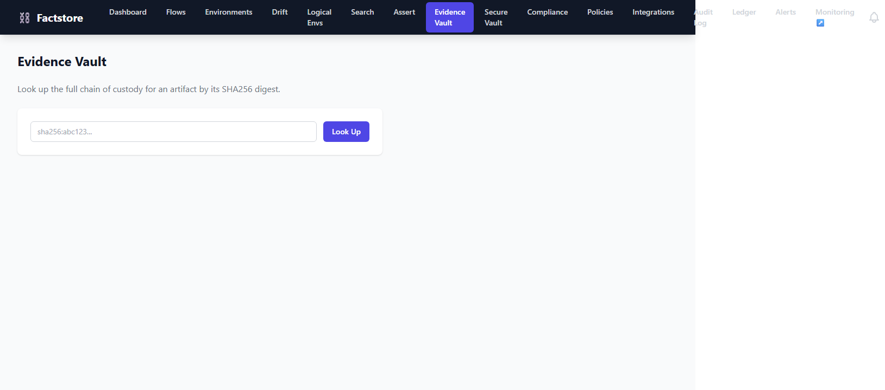

### Key Elements

| Element | Description |
|---------|-------------|
| Evidence file list | Shows file name, associated attestation type, content hash, and upload timestamp |
| Filter controls | Filter by attestation type or search by file name |
| **Download** action | Retrieve the original evidence payload |

### Activity: Locating a specific evidence file

1. Navigate to `/evidence`.
2. Use the filter controls to narrow by attestation type (e.g. `snyk`).
3. Click the file name or **Download** to inspect the raw evidence payload.

---

## 10. Environments

**Navigate to:** `/environments`

Environments represent named deployment targets (e.g. `production`, `staging`, `uat`). Each environment holds a **snapshot** — a point-in-time record of which artifact digests are currently running there.

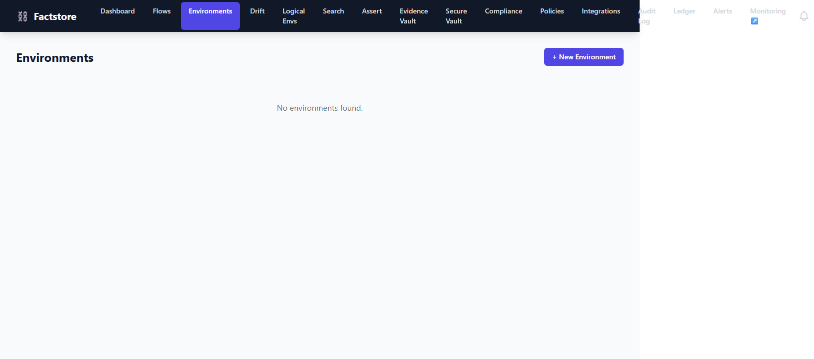

### Key Elements

| Element | Description |
|---------|-------------|
| Environments table | Lists environment name, current snapshot timestamp, and artifact count |
| **+ New Environment** button | Register a new deployment target |
| Row click → Detail view | Shows the full artifact snapshot for that environment |

### Activity: Checking what is deployed in production

1. Navigate to `/environments`.
2. Click the `production` environment row.
3. The detail view shows every artifact digest currently recorded in that environment's latest snapshot, along with their compliance status.

> **Note:** Snapshots are updated by your CI/CD pipeline via the API. A stale snapshot may not reflect the current live state.

---

## 11. Logical Environments

**Navigate to:** `/logical-environments`

Logical Environments group one or more physical environments under a single named abstraction (e.g. `eu-region` encompasses `eu-prod-1` and `eu-prod-2`). This enables cross-environment compliance checks at a higher level of granularity.

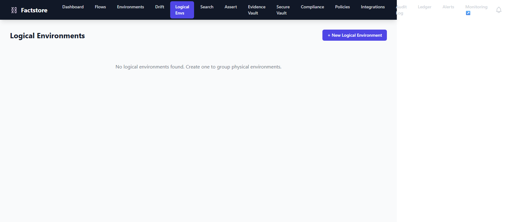

### Key Elements

| Element | Description |
|---------|-------------|
| Logical environment list | Name, description, and the physical environments it contains |
| **+ New Logical Environment** button | Create a new grouping |
| Detail view | Shows aggregate compliance status across all member environments |

### Activity: Creating a logical environment group

1. Navigate to `/logical-environments` via the **Logical Envs** nav link.
2. Click **+ New Logical Environment**.
3. Provide a name and select the physical environments to include.
4. Click **Create**.

---

## 12. Audit Log

**Navigate to:** `/audit`

The Audit Log provides a tamper-evident, append-only record of every mutation in the system — flow creation, trail updates, attestation submissions, deployment snapshots, and more.

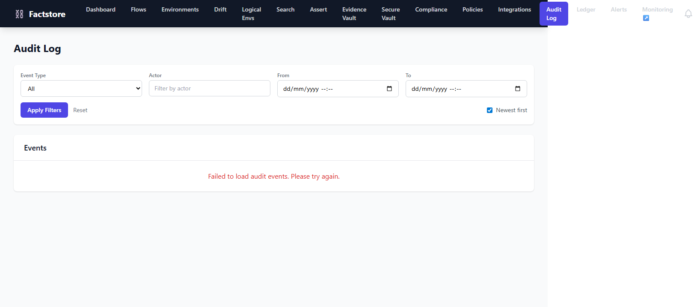

### Key Elements

| Element | Description |
|---------|-------------|
| **Event Type** filter | Dropdown to scope the log to a specific event class |
| **Filter by actor** field | Free-text filter on the identity that triggered the event |
| Log entries | Timestamped list of events with actor, resource type, and resource ID |

### Activity: Investigating a compliance breach

1. Navigate to `/audit`.
2. Set **Event Type** to `ATTESTATION_SUBMITTED` to find recently attached evidence.
3. Filter by the actor (CI job name or user identity) responsible for the build in question.
4. Inspect the matching entries to trace the timeline of attestation submissions.

---

## 13. Deployment Policies

**Navigate to:** `/policies`

Deployment Policies define machine-readable rules — backed by OPA (Open Policy Agent) expressions — that gate whether an artifact may be promoted to an environment.

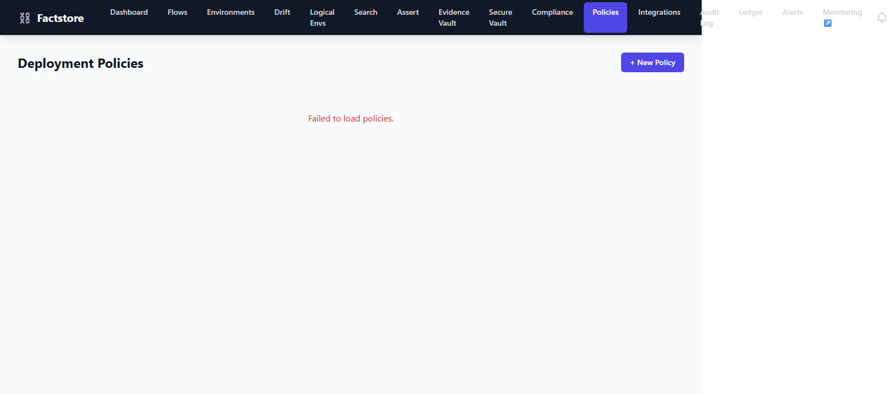

### Key Elements

| Element | Description |
|---------|-------------|
| Policies table | Name, type, threshold, signature required flag, evaluator (e.g. `OPA`) |
| **+ New Policy** button | Opens the policy creation modal |
| **Edit** / **Delete** actions | Modify or remove an existing policy |

### Activity: Creating a policy that requires a security scan

1. Navigate to `/policies`.
2. Click **+ New Policy**.
3. Configure:
   - **Name** — e.g. `require-snyk-scan`.
   - **Type** — `ATTESTATION_REQUIRED`.
   - **Evaluator** — `OPA`.
   - **Expression** — OPA Rego rule body.
4. Click **Create**.
5. Attach the policy to the relevant Flow.

> **Tip:** Use `factstore.cqrs.role` to deploy a read-only query replica that evaluates policies without affecting the write path.

---

## 14. Compliance Frameworks

**Navigate to:** `/compliance`

The Compliance Frameworks page lets you browse pre-built framework templates (e.g. ISO 27001, SOC 2, PCI DSS) and import them directly as Flows — so your pipelines are pre-wired with all the required attestation types for a given regulation.

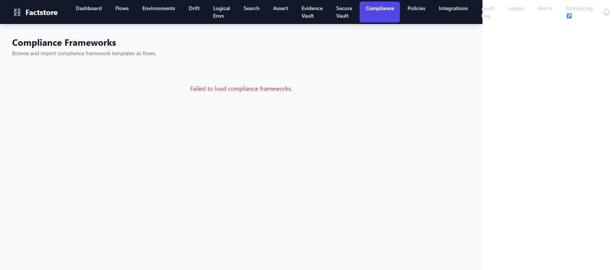

### Key Elements

| Element | Description |
|---------|-------------|
| Framework cards | Name, description, and required attestation type count |
| **Import as Flow** button | Creates a new Flow pre-populated with the framework's required attestations |

### Activity: Bootstrapping a PCI DSS pipeline

1. Navigate to `/compliance`.
2. Find the **PCI DSS** card.
3. Click **Import as Flow**.
4. Optionally adjust the flow name and description.
5. Confirm — your new Flow is created with all PCI DSS-mandated attestation types.

---

## 15. Drift Detection

**Navigate to:** `/drift`

Drift Detection continuously monitors your environments for **artifact drift** — situations where a running artifact digest is not on the approved allowlist or does not meet compliance requirements.

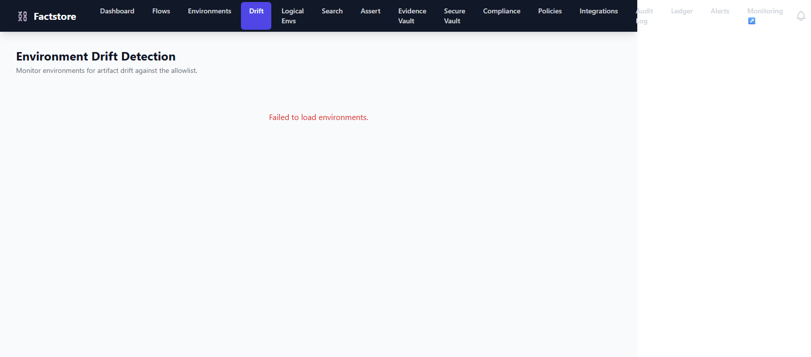

### Key Elements

| Element | Description |
|---------|-------------|
| Environment drift cards | Per-environment list of drifted artifacts |
| Drift indicator | `DRIFTED` (red) vs `IN_SYNC` (green) status per environment |
| Artifact digest + expected vs actual | Shows what should be running vs what is |

### Activity: Remediating a drifted environment

1. Navigate to `/drift`.
2. Identify environments with a `DRIFTED` status.
3. For each drifted artifact, check whether a compliant build exists in the Evidence Vault.
4. Re-deploy the compliant artifact digest to restore `IN_SYNC` status.

---

## 16. Search

**Navigate to:** `/search`

Global Search allows you to find trails, artifacts, and attestations by branch name, author, image name, or SHA256 digest.

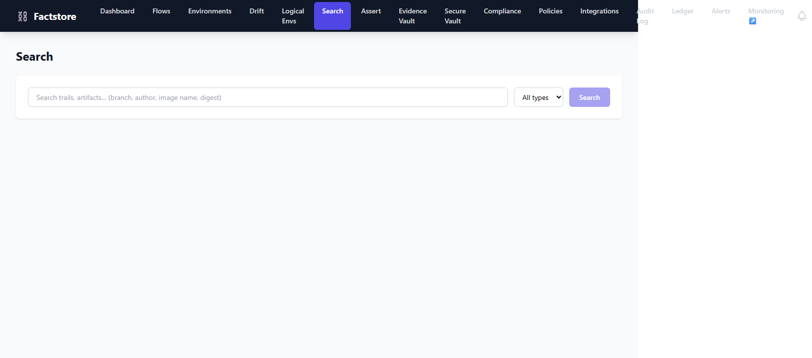

### Key Elements

| Element | Description |
|---------|-------------|
| Search input | Accepts branch names, author identities, image names, or `sha256:` digests |
| **Type** filter | Scopes results to `trail`, `artifact`, or `attestation` |
| Result rows | Linked to the corresponding detail pages |

### Activity: Finding all builds for a specific branch

1. Navigate to `/search`.
2. Type the branch name (e.g. `feature/payment-refactor`) into the search input.
3. Set the **Type** filter to `trail`.
4. Press **Search** or hit Enter.
5. Click any result row to open the trail detail view.

---

## 17. Attestation Types


The **Attestation Types** page (`/attestation-types`) is your organisation's registry of all recognised quality gate categories. Each type defines the shape of evidence that must be collected before a trail is considered compliant.

### Viewing types

The table lists every type with its **Name**, **Description**, **Version**, and **Status** (Active / Archived). Archived types remain visible when "Show archived types" is checked — they still appear on historic trails but can no longer be assigned to new flows.

### Creating a type

1. Click **+ New Type** in the top-right corner.
2. Enter a **Name** (e.g., `SAST`, `SBOM`, `DAST`), an optional **Description**, and a **JSON Schema** that describes the expected payload structure.
3. Optionally add a **jq expression** — a filter evaluated against the attestation payload to compute the `PASSED` / `FAILED` status automatically.
4. Click **Save**.

### JSON Schema example

```json
{
  "$schema": "http://json-schema.org/draft-07/schema#",
  "type": "object",
  "required": ["tool", "result"],
  "properties": {
    "tool":   { "type": "string" },
    "result": { "enum": ["PASSED", "FAILED", "SKIPPED"] },
    "issues": { "type": "integer", "minimum": 0 }
  }
}
```

Any attestation payload submitted against this type is validated against the schema. A non-conforming payload is rejected with HTTP 422.

### jq compliance expression example

```
.result == "PASSED" and .issues == 0
```

If the expression evaluates to `true` the attestation receives status `PASSED`; `false` maps to `FAILED`. Omit the field to leave status determination to the CI pipeline.

### Editing and archiving

Click **Edit** on a row to update the description or schema. Each save bumps the **Version** counter. To retire a type without deleting historical data, click **Archive**.

---

## 18. Compliance Posture


The **Compliance Posture** dashboard (`/compliance-posture`) gives leadership a bird's-eye view of compliance health across every flow in the organisation.

### Summary cards

| Card | Description |
|------|-------------|
| **Total Flows** | Number of active delivery pipelines |
| **Compliant Trails %** | Percentage of all trails that have passed every required attestation |
| **Non-Compliant Trails** | Count of trails with at least one `FAILED` or missing attestation |
| **Pending Trails** | Trails that are still accumulating evidence |

### Per-flow breakdown

The table beneath the summary cards shows one row per flow:

- **Total Trails** — all trails ever opened for the flow.
- **Compliant / Non-Compliant / Pending** — breakdown by trail status.
- **Compliance %** — colour-coded: green ≥ 80%, yellow ≥ 50%, red < 50%.

Click any flow name to navigate to its trail list for deeper investigation.

### Interpreting the dashboard

A high **Pending** count typically means CI pipelines have not completed yet or evidence upload is failing silently. Check the trail detail view and verify that attestation steps are executing and posting results via the API or CLI.

---

## 19. Snapshot Diff


The **Snapshot Diff** viewer (`/environments/:id/snapshot-diff`) lets you compare two point-in-time snapshots of an environment to understand exactly what changed between them.

### Opening the diff viewer

From any Environment detail page, click **Compare Snapshots** to open the diff view for that environment.

### Selecting snapshots

Use the two drop-downs to choose **Snapshot A** (older) and **Snapshot B** (newer). Each entry shows its sequence number and the timestamp at which it was recorded. Click **Compare** to run the diff.

### Reading the diff table

| Column | Meaning |
|--------|---------|
| **Image** | Container image name and tag |
| **Digest A** | SHA-256 digest in the older snapshot |
| **Digest B** | SHA-256 digest in the newer snapshot |
| **Change** | `ADDED`, `REMOVED`, or `CHANGED` |

Rows highlighted in green represent newly deployed images; rows in red are images that were removed; rows in amber indicate digest changes (i.e., the same tag now points to a different image).

### Typical use-cases

- **Incident investigation** — identify which images changed around the time of an outage.
- **Deployment verification** — confirm that a release promoted exactly the expected images and nothing else changed.
- **Compliance audit** — demonstrate to auditors that only approved artifacts entered the production environment between two dates.

---

## 20. API Feature Guide

These features are driven through the HTTP API. Every example sends `Authorization: Bearer $FACTSTORE_TOKEN` and uses `$BASE_URL` for the command service; see [Setup & Installation](#3-setup--installation).

### Flow Tags

Flows support arbitrary key-value tags for filtering, reporting, and multi-team organisation.

```bash
# Create a flow with tags
curl -s -X POST "$BASE_URL/api/v1/flows" \
  -H "Authorization: Bearer $FACTSTORE_TOKEN" \
  -H "Content-Type: application/json" \
  -d '{
    "name": "payments-service",
    "requiredAttestationTypes": ["junit", "trivy"],
    "tags": {
      "team": "payments",
      "criticality": "high",
      "pci-scope": "true"
    }
  }' | jq .
```

Use tags to group flows for dashboards, notifications, and policy rules. Tags do not affect compliance evaluation.

### Flow Template YAML Specs

Define a flow's requirements as a YAML template, kept in your repository, and send it as `templateYaml` when you create or update the flow. Read back the template a flow carries, and the effective template after any catalogue templates are combined:

```bash
curl -s -H "Authorization: Bearer $FACTSTORE_TOKEN" "$BASE_URL/api/v1/flows/$FLOW_ID/template" | jq .
# { "flowId": "...", "templateYaml": "version: 1\n...", "effectiveTemplate": ... }
```

The template catalogue, combining templates and template drift are covered in [Flow templates](./flow-templates.md).

#### Conditional Attestation Rules

Attestations in a flow template can include an `if:` expression to make them conditional. The rule is only enforced when the expression evaluates to `true` at assertion time.

```yaml
version: 1
trail:
  attestations:
    - name: jira-ticket
      type: jira
artifacts:
  - name: backend
    attestations:
      - name: unit-tests
        type: junit
      - name: security-scan
        type: snyk
        if: 'flow.tags["pci-scope"] == "true"'
      - name: sonar-gate
        type: sonar
        if: 'matches(artifact.name, "^backend.*")'
```

**Supported expression syntax** (evaluated by `PolicyExpressionEvaluator`):

| Expression | Example |
|------------|---------|
| Equality | `flow.name == "payments-service"` |
| Inequality | `flow.name != "test-flow"` |
| Regex match | `matches(artifact.name, "^backend.*")` |
| Existence check | `exists(flow)` |
| List membership | `flow.name in ["svc-a", "svc-b"]` |
| Logical AND | `exists(flow) and flow.name == "x"` |
| Logical OR | `flow.name == "a" or flow.name == "b"` |
| Negation | `not exists(flow)` |

Malformed expressions default to `false` (never throw an exception).

### Organisation Multi-tenancy

OpenFactstore supports multiple tenants via **Organisations**. Each organisation has its own flows, users, and integrations, fully isolated from other organisations.

```bash
# Create an organisation
curl -s -X POST "$BASE_URL/api/v1/organisations" \
  -H "Authorization: Bearer $FACTSTORE_TOKEN" \
  -H "Content-Type: application/json" \
  -d '{
    "name": "ACME Corp",
    "slug": "acme-corp"
  }' | jq .

# List flows scoped to an organisation
curl -s -H "Authorization: Bearer $FACTSTORE_TOKEN" "$BASE_URL/api/v1/organisations/acme-corp/flows" | jq .

# Invite a user to an organisation
curl -s -X POST "$BASE_URL/api/v1/organisations/acme-corp/members" \
  -H "Authorization: Bearer $FACTSTORE_TOKEN" \
  -H "Content-Type: application/json" \
  -d '{
    "email": "dev@acme.example",
    "role": "MEMBER"
  }' | jq .
```

**Member roles:** `ADMIN`, `MEMBER`, `VIEWER` (people) and `SERVICE_ACCOUNT`; see [Signing In and Roles](#signing-in-and-roles).

### Release Approval Workflow

For high-risk deployments, require explicit human approval before a trail can be considered compliant.

```bash
# Request approval for a trail
curl -s -X POST "$BASE_URL/api/v1/trails/$TRAIL_ID/approvals" \
  -H "Authorization: Bearer $FACTSTORE_TOKEN" \
  -H "Content-Type: application/json" \
  -d "{
    \"trailId\": \"$TRAIL_ID\",
    \"requiredApprovers\": [\"alice\"],
    \"comments\": \"Release v1.2.3 to production\"
  }" | jq .
# Keep the approval's "id" as APPROVAL_ID

# Approve (by an authorised reviewer)
curl -s -X POST "$BASE_URL/api/v1/approvals/$APPROVAL_ID/approve" \
  -H "Authorization: Bearer $FACTSTORE_TOKEN" \
  -H "Content-Type: application/json" \
  -d '{
    "approverIdentity": "alice",
    "comments": "LGTM — all checks pass"
  }' | jq .

# Reject
curl -s -X POST "$BASE_URL/api/v1/approvals/$APPROVAL_ID/reject" \
  -H "Authorization: Bearer $FACTSTORE_TOKEN" \
  -H "Content-Type: application/json" \
  -d '{
    "approverIdentity": "bob",
    "comments": "Pending security review"
  }' | jq .
```

> 💡 **Pro-tip:** Configure the Slack integration (**Integrations** in the web UI) so reviewers receive an interactive approval request directly in their Slack workspace.

### Deployment Gate & Policy Engine

The deployment gate evaluates whether an artifact is cleared to deploy to a specific environment, applying both compliance rules and deployment policies.

```bash
# Create a deployment policy
curl -s -X POST "$BASE_URL/api/v1/deployment-policies" \
  -H "Authorization: Bearer $FACTSTORE_TOKEN" \
  -H "Content-Type: application/json" \
  -d '{
    "name": "production-gate",
    "flowId": "'$FLOW_ID'",
    "environmentId": "'$ENV_ID'",
    "enforceApprovals": true,
    "requiredAttestationTypes": ["junit", "trivy"]
  }' | jq .

# Evaluate the deployment gate
curl -s -X POST "$BASE_URL/api/v1/gate/evaluate" \
  -H "Authorization: Bearer $FACTSTORE_TOKEN" \
  -H "Content-Type: application/json" \
  -d '{
    "artifactSha256": "'$DIGEST'",
    "environmentId": "'$ENV_ID'",
    "requestedBy": "deploy-pipeline"
  }' | jq .
```

**Gate response:**
```json
{
  "id": "4b0f2c8e-0000-0000-0000-000000000001",
  "decision": "ALLOWED",
  "artifactSha256": "sha256:e3b0c44298fc1c149afbf4c8996fb92427ae41e4649b934ca495991b7852b855",
  "environmentId": "7e2c9d4a-0000-0000-0000-000000000001",
  "evaluatedAt": "2026-01-01T10:06:00Z",
  "blockReasons": [],
  "policiesEvaluated": 1,
  "signatureVerified": null
}
```

`decision` is `ALLOWED` or `BLOCKED`; `blockReasons` says why.

#### Custom Policy YAML

Attach a YAML policy to an environment for fine-grained control over what evidence is required. Policies support the same conditional `if:` expression syntax as flow templates:

```yaml
_schema: "https://factstore.io/policy/v1"
artifacts:
  provenance:
    required: true
  trail-compliance:
    required: true
  attestations:
    - name: junit
      type: junit
    - name: security-scan
      type: snyk
      if: 'flow.name == "payments-service"'
    - name: sonar-gate
      type: sonar
      if: 'matches(artifact.name, "^backend.*")'
```

```bash
# Create the policy from a YAML file, then attach it to an environment
POLICY_ID=$(jq -n --rawfile yaml pci-baseline.yaml '{name: "pci-baseline", policyYaml: $yaml}' \
  | curl -s -X POST "$BASE_URL/api/v1/policies" \
      -H "Authorization: Bearer $FACTSTORE_TOKEN" \
      -H "Content-Type: application/json" \
      -d @- | jq -r .id)

curl -s -X POST "$BASE_URL/api/v1/policy-attachments" \
  -H "Authorization: Bearer $FACTSTORE_TOKEN" \
  -H "Content-Type: application/json" \
  -d '{"policyId": "'$POLICY_ID'", "environmentId": "'$ENV_ID'"}' | jq .
```

### Environment Drift Detection

Track what is deployed in each environment, compare snapshots, and detect when environments diverge from their baseline.

```bash
# Register an environment
curl -s -X POST "$BASE_URL/api/v1/environments" \
  -H "Authorization: Bearer $FACTSTORE_TOKEN" \
  -H "Content-Type: application/json" \
  -d '{
    "name": "production",
    "type": "K8S",
    "description": "Production Kubernetes cluster"
  }' | jq .
# Keep the environment's "id" as ENV_ID. Types: K8S, ECS, LAMBDA, S3, DOCKER, GENERIC

# Record a snapshot (what is currently deployed)
curl -s -X POST "$BASE_URL/api/v1/environments/$ENV_ID/snapshots" \
  -H "Authorization: Bearer $FACTSTORE_TOKEN" \
  -H "Content-Type: application/json" \
  -d '{
    "recordedBy": "k8s-reporter",
    "artifacts": [
      {
        "artifactName": "my-service",
        "artifactSha256": "sha256:e3b0c44298fc1c149afbf4c8996fb92427ae41e4649b934ca495991b7852b855",
        "artifactTag": "v1.2.3"
      }
    ]
  }' | jq .

# Set a baseline (the known-good state)
curl -s -X POST "$BASE_URL/api/v1/environments/$ENV_ID/baselines" \
  -H "Authorization: Bearer $FACTSTORE_TOKEN" \
  -H "Content-Type: application/json" \
  -d '{ "approvedBy": "alice", "description": "Post-release v1.2.3 baseline" }' | jq .

# Check for drift (after a new snapshot)
curl -s -H "Authorization: Bearer $FACTSTORE_TOKEN" "$BASE_URL/api/v1/environments/$ENV_ID/drift" | jq .
```

### Allow-listing Third-party Artifacts

Not all deployed artifacts are built by your own pipelines (e.g. sidecar proxies, operator images). Add them to the environment allow-list to prevent false drift alerts.

```bash
curl -s -X POST "$BASE_URL/api/v1/environments/$ENV_ID/allowlist" \
  -H "Authorization: Bearer $FACTSTORE_TOKEN" \
  -H "Content-Type: application/json" \
  -d '{
    "namePattern": "envoyproxy/envoy*",
    "reason": "Managed by platform team — not built by app pipeline",
    "approvedBy": "platform-lead"
  }' | jq .
```

### Snapshotting Scopes

An environment can be given a snapshot **scope** when it is created (the `scope` field of `POST /api/v1/environments`): which namespaces or name patterns its snapshots include. Each snapshot then records what is running in that scope:

```bash
curl -s -X POST "$BASE_URL/api/v1/environments/$ENV_ID/snapshots" \
  -H "Authorization: Bearer $FACTSTORE_TOKEN" \
  -H "Content-Type: application/json" \
  -d '{
    "recordedBy": "k8s-reporter",
    "artifacts": [
      { "artifactName": "payments-api",    "artifactSha256": "sha256:<64 hex>", "artifactTag": "v2.1.0" },
      { "artifactName": "payments-worker", "artifactSha256": "sha256:<64 hex>", "artifactTag": "v2.1.0" }
    ]
  }' | jq .
```

Diff two snapshots by their index:

```bash
curl -s -H "Authorization: Bearer $FACTSTORE_TOKEN" "$BASE_URL/api/v1/environments/$ENV_ID/diff?from=1&to=2" | jq .
```

### Pull Request Attestation

Record an attestation sourced directly from your SCM (GitHub, GitLab, Bitbucket) to prove a PR exists, was reviewed, and was merged by an authorised author.

**Step 1 — Register an SCM integration for your organisation:**

```bash
curl -s -X POST "$BASE_URL/api/v1/organisations/acme-corp/scm-integrations" \
  -H "Authorization: Bearer $FACTSTORE_TOKEN" \
  -H "Content-Type: application/json" \
  -d '{
    "provider": "GITHUB",
    "token": "ghp_your_token_here"
  }' | jq .
```

> 💡 **Pro-tip:** The token is encrypted at rest using AES-256-GCM. Set `SCM_ENCRYPTION_KEY` to a strong, random 32-character key in production. If Vault is enabled (`VAULT_ENABLED=true`), tokens are additionally stored in HashiCorp Vault.

**Step 2 — Record a PR attestation:**

```bash
curl -s -X POST "$BASE_URL/api/v1/trails/$TRAIL_ID/attestations/pull-request" \
  -H "Authorization: Bearer $FACTSTORE_TOKEN" \
  -H "Content-Type: application/json" \
  -d '{
    "provider": "GITHUB",
    "repository": "my-org/my-service",
    "commitSha": "e67f2f2b121f9325ebf166b7b3c707f73cb48b14",
    "orgSlug": "acme-corp",
    "assertOnMissing": true
  }' | jq .
```

OpenFactstore finds the pull requests that contain the commit and fetches their details (title, author, merge status, reviewers) from the SCM and stores the evidence automatically.

### Security Scan Integration

Record the output of any security scanner (Snyk, Trivy, Grype, Semgrep) as a structured attestation.

```bash
curl -s -X POST "$BASE_URL/api/v1/trails/$TRAIL_ID/security-scans" \
  -H "Authorization: Bearer $FACTSTORE_TOKEN" \
  -H "Content-Type: application/json" \
  -d '{
    "tool": "trivy",
    "toolVersion": "0.50.0",
    "target": "my-service:v1.2.3",
    "criticalVulnerabilities": 0,
    "highVulnerabilities": 1,
    "mediumVulnerabilities": 3,
    "lowVulnerabilities": 12,
    "reportUrl": "https://ci.example.com/scans/42"
  }' | jq .

# Set thresholds that a flow must satisfy
curl -s -X POST "$BASE_URL/api/v1/flows/$FLOW_ID/security-thresholds" \
  -H "Authorization: Bearer $FACTSTORE_TOKEN" \
  -H "Content-Type: application/json" \
  -d '{
    "maxCritical": 0,
    "maxHigh": 0,
    "maxMedium": 10
  }' | jq .
```

### OPA Policy Integration

Upload Rego policies and evaluate any artifact's compliance facts against your custom policies using [Open Policy Agent](https://www.openpolicyagent.org/).

```bash
# Upload a Rego policy (keep the response's "id" as BUNDLE_ID)
jq -n --rawfile rego security-baseline.rego '{name: "security-baseline", version: "1", regoContent: $rego}' \
  | curl -s -X POST "$BASE_URL/api/v1/opa/bundles" \
      -H "Authorization: Bearer $FACTSTORE_TOKEN" \
      -H "Content-Type: application/json" \
      -d @- | jq .

# Activate the bundle
curl -s -H "Authorization: Bearer $FACTSTORE_TOKEN" -X PUT "$BASE_URL/api/v1/opa/bundles/$BUNDLE_ID/activate" | jq .

# Evaluate an artifact against the active policy
curl -s -X POST "$BASE_URL/api/v1/opa/evaluate" \
  -H "Authorization: Bearer $FACTSTORE_TOKEN" \
  -H "Content-Type: application/json" \
  -d '{
    "artifactName": "my-service",
    "artifactVersion": "v1.2.3",
    "environment": "production",
    "attestations": [ { "type": "junit", "status": "PASSED" } ]
  }' | jq .
```

All policy decisions are logged and queryable via `GET /api/v1/opa/decisions`.

### Regulatory Compliance Framework

Map your compliance flows to regulatory controls (SOX, PCI-DSS, GDPR, ISO 27001) and generate audit reports automatically.

```bash
# Create a regulatory framework
curl -s -X POST "$BASE_URL/api/v1/frameworks" \
  -H "Authorization: Bearer $FACTSTORE_TOKEN" \
  -H "Content-Type: application/json" \
  -d '{
    "name": "PCI-DSS",
    "version": "4.0",
    "description": "Payment Card Industry Data Security Standard"
  }' | jq .
# Keep the framework's "id" as FRAMEWORK_ID

# Add controls to the framework
curl -s -X POST "$BASE_URL/api/v1/frameworks/$FRAMEWORK_ID/controls" \
  -H "Authorization: Bearer $FACTSTORE_TOKEN" \
  -H "Content-Type: application/json" \
  -d '{
    "controlId": "6.3.3",
    "title": "Software components are protected from known vulnerabilities",
    "requiredEvidenceTypes": ["trivy"]
  }' | jq .
# Keep the control's "id" (a UUID, not "6.3.3") as CONTROL_ID

# Map a compliance flow to a control
curl -s -X POST "$BASE_URL/api/v1/compliance/mappings" \
  -H "Authorization: Bearer $FACTSTORE_TOKEN" \
  -H "Content-Type: application/json" \
  -d '{
    "regulatoryControlId": "'$CONTROL_ID'",
    "flowId": "'$FLOW_ID'",
    "attestationType": "trivy"
  }' | jq .

# Run a compliance assessment
curl -s -X POST "$BASE_URL/api/v1/compliance/assess" \
  -H "Authorization: Bearer $FACTSTORE_TOKEN" \
  -H "Content-Type: application/json" \
  -d '{
    "trailId": "'$TRAIL_ID'",
    "frameworkId": "'$FRAMEWORK_ID'"
  }' | jq .

# Generate a regulatory report
curl -s -H "Authorization: Bearer $FACTSTORE_TOKEN" "$BASE_URL/api/v1/reports/regulatory/$FRAMEWORK_ID" | jq .
```

### Dry-run Safe Mode

Use the `X-Factstore-Dry-Run: true` header on any mutating request to preview what would happen without persisting any data.

```bash
# Simulate an assertion without recording the result
curl -s -X POST "$BASE_URL/api/v1/assert" \
  -H "Authorization: Bearer $FACTSTORE_TOKEN" \
  -H "Content-Type: application/json" \
  -H "X-Factstore-Dry-Run: true" \
  -d '{
    "flowId": "'$FLOW_ID'",
    "sha256Digest": "sha256:e3b0c44..."
  }' | jq .
```

The response is `{"dryRun": true, "wouldCreate": { ... }}`, where `wouldCreate` is the result the request would have produced. No side-effects are committed.

> 💡 **Pro-tip:** Use dry-run in pull request CI checks to validate that the artifact *would* be compliant without actually recording a compliance result. This gives early feedback without polluting the audit trail.

### OIDC Provenance Attestation

Record a CI/CD identity token (OIDC JWT) issued by GitHub Actions or GitLab as a tamper-evident provenance attestation. This proves _which pipeline_ ran — not just that a build happened — by capturing the signed identity claims from the CI provider.

**Allowed issuers:**
- `https://token.actions.githubusercontent.com` (GitHub Actions)
- `https://gitlab.com` (GitLab CI/CD)

The server verifies the token's **signature** against the issuer's published keys, and checks that the issuer is trusted, that `aud` is `factstore` (request the token with that audience, as below; configurable with `factstore.oidc.audience`), and that it has not expired. It then enforces **jti replay-protection**: each token can be submitted once. A token that fails any check is refused with `400` and nothing is recorded. More issuers, such as a self-managed GitLab, are trusted with `factstore.oidc.extra-issuers=<issuer>|<jwks-uri>`.

**GitHub Actions — obtain and submit OIDC token:**

```yaml
# .github/workflows/build.yml
- name: Record OIDC provenance attestation
  permissions:
    id-token: write   # required to request the OIDC JWT
  run: |
    TOKEN=$(curl -sS -H "Authorization: bearer $ACTIONS_ID_TOKEN_REQUEST_TOKEN" \
      "$ACTIONS_ID_TOKEN_REQUEST_URL&audience=factstore" | jq -r '.value')

    curl -s -X POST "${{ vars.FACTSTORE_BASE_URL }}/api/v2/attestations/oidc" \
      -H "Authorization: Bearer ${{ secrets.FACTSTORE_API_TOKEN }}" \
      -H "Content-Type: application/json" \
      -d "{
        \"trailId\": \"${{ env.TRAIL_ID }}\",
        \"token\": \"$TOKEN\",
        \"orgSlug\": \"${{ vars.FACTSTORE_ORG_SLUG }}\"
      }" | jq .
```

**Response:**
```json
{
  "id": "attest-uuid",
  "trailId": "trail-uuid",
  "type": "oidc-provenance",
  "status": "PASSED",
  "details": {
    "issuer": "https://token.actions.githubusercontent.com",
    "subject": "repo:my-org/my-service:ref:refs/heads/main",
    "repository": "my-org/my-service",
    "workflow": ".github/workflows/build.yml",
    "ref": "refs/heads/main",
    "sha": "abc123def456",
    "actor": "alice"
  }
}
```

> 💡 **Pro-tip:** OIDC provenance is particularly valuable under PCI-DSS and SOX requirements for proving that production deployments originated from a known, audited pipeline — not a developer's laptop.

### Attestation Type Processors

When you upload an evidence file to an attestation of certain types, OpenFactstore **automatically parses the content** and sets `PASSED` or `FAILED` without you having to specify the status manually. Evidence is uploaded as a multipart file to `POST /api/v1/trails/{trailId}/attestations/{attestationId}/evidence`.

#### JUnit XML → `junit` attestations

Upload JUnit XML test results — OpenFactstore counts `failures` and `errors` across all `<testsuite>` elements.

```bash
# Record a junit attestation and upload XML evidence
ATTEST_ID=$(curl -s -X POST "$BASE_URL/api/v1/trails/$TRAIL_ID/attestations" \
  -H "Authorization: Bearer $FACTSTORE_TOKEN" \
  -H "Content-Type: application/json" \
  -d '{"type": "junit", "details": "Unit test results"}' | jq -r .id)

curl -s -X POST "$BASE_URL/api/v1/trails/$TRAIL_ID/attestations/$ATTEST_ID/evidence" \
  -H "Authorization: Bearer $FACTSTORE_TOKEN" \
  -F "file=@target/surefire-reports/TEST-results.xml" | jq .
# → status auto-set to PASSED (0 failures) or FAILED (failures/errors > 0)
# → details: {"tests":247,"failures":0,"errors":0,"skipped":3}
```

#### Snyk / SARIF JSON → `snyk` attestations

Upload a Snyk JSON output or any SARIF-format file.

```bash
curl -s -X POST "$BASE_URL/api/v1/trails/$TRAIL_ID/attestations/$ATTEST_ID/evidence" \
  -H "Authorization: Bearer $FACTSTORE_TOKEN" \
  -F "file=@snyk-results.json" | jq .
# → PASSED if vulnerabilities == 0, FAILED otherwise
# → details: {"vulnerabilities":0}
```

#### SonarQube Quality Gate → `sonar` attestations

Upload the SonarQube quality gate API response (`/api/qualitygates/project_status`).

```bash
# Fetch quality gate status from SonarQube and submit as evidence
curl -s -u "$SONAR_TOKEN:" "$SONAR_HOST/api/qualitygates/project_status?projectKey=my-service" > sonar-status.json

curl -s -X POST "$BASE_URL/api/v1/trails/$TRAIL_ID/attestations/$ATTEST_ID/evidence" \
  -H "Authorization: Bearer $FACTSTORE_TOKEN" \
  -F "file=@sonar-status.json;type=application/json" | jq .
# → PASSED if projectStatus.status == "OK", FAILED otherwise
# → details: {"qualityGateStatus":"OK"}
```

#### Jira Issue Reference → `jira` attestations

Submit a Jira issue key (e.g. `PROJ-123`) or a JSON body with `issueRef`.

```bash
# Plain issue key
printf 'PROJ-123' > jira-ref.txt
curl -s -X POST "$BASE_URL/api/v1/trails/$TRAIL_ID/attestations/$ATTEST_ID/evidence" \
  -H "Authorization: Bearer $FACTSTORE_TOKEN" \
  -F "file=@jira-ref.txt;type=text/plain" | jq .
# → PASSED (matches [A-Z]+-\d+ pattern), FAILED otherwise
# → details: {"issueRef":"PROJ-123"}

# JSON: {"issueRef": "PROJ-123", "status": "Done"}
curl -s -X POST "$BASE_URL/api/v1/trails/$TRAIL_ID/attestations/$ATTEST_ID/evidence" \
  -H "Authorization: Bearer $FACTSTORE_TOKEN" \
  -F "file=@jira-ref.json;type=application/json" | jq .
```

---

## 21. CI/CD Integration

**Quick example — GitHub Actions:**

```yaml
- name: Create Factstore trail
  run: |
    curl -s -X POST "${{ vars.FACTSTORE_BASE_URL }}/api/v1/trails" \
      -H "Authorization: Bearer ${{ secrets.FACTSTORE_API_TOKEN }}" \
      -H "Content-Type: application/json" \
      -H "X-Factstore-CI-Context: github-actions" \
      -d '{
        "flowId": "${{ vars.FACTSTORE_FLOW_ID }}",
        "gitAuthor": "${{ github.actor }}",
        "gitAuthorEmail": "${{ github.actor }}@users.noreply.github.com"
      }'

- name: Assert compliance before deploy
  run: |
    RESULT=$(curl -s -X POST "${{ vars.FACTSTORE_BASE_URL }}/api/v1/assert" \
      -H "Authorization: Bearer ${{ secrets.FACTSTORE_API_TOKEN }}" \
      -H "Content-Type: application/json" \
      -d '{"flowId":"${{ vars.FACTSTORE_FLOW_ID }}","sha256Digest":"'"$DIGEST"'"}')
    STATUS=$(echo "$RESULT" | jq -r '.status')
    if [ "$STATUS" != "COMPLIANT" ]; then
      echo "Deployment blocked: artifact is not compliant"
      exit 1
    fi
```

The `X-Factstore-CI-Context` header instructs the server to auto-populate `gitCommitSha`, `gitBranch`, and `buildUrl` from the CI environment's standard variables. See [docs/ci-integration.md](./ci-integration.md) for all supported CI systems (GitHub Actions, GitLab CI, Jenkins, CircleCI, Azure DevOps).

> 💡 **Terraform bootstrap in CI:** Use the `infra/` Terraform configuration to provision your Factstore instance's resources (environments, policies, flows) as code. The `.github/workflows/terraform-verify.yml` workflow demonstrates a full end-to-end verification: it starts the backend, applies the Terraform config, and asserts all resources exist before teardown. See [Infrastructure as Code — Terraform](#22-infrastructure-as-code--terraform).

See **[docs/ci-integration.md](./ci-integration.md)** for the complete guide, including examples for:

- **GitHub Actions** (with `X-Factstore-CI-Context: github-actions`)
- **GitLab CI/CD** (with `X-Factstore-CI-Context: gitlab-ci`)
- **Jenkins** (with `X-Factstore-CI-Context: jenkins`)
- **CircleCI** (with `X-Factstore-CI-Context: circleci`)
- **Azure DevOps** (with `X-Factstore-CI-Context: azure-devops`)

The `X-Factstore-CI-Context` header auto-populates `gitCommitSha`, `gitBranch`, and `buildUrl` from well-known CI environment variables. Explicitly provided fields in the request body always take precedence.

### GitHub Actions composite action

OpenFactstore ships a reusable **composite GitHub Actions action** at `.github/actions/factstore-attest/` that records attestations directly from your CI workflows.

#### Quick-start example

```yaml
# .github/workflows/ci.yml
name: CI

on: [push]

jobs:
  build:
    runs-on: ubuntu-latest
    steps:
      - uses: actions/checkout@v4

      - name: Build and push image
        id: build
        run: |
          docker build -t myapp:${{ github.sha }} .
          docker push myapp:${{ github.sha }}
          DIGEST=$(docker inspect --format='{{index .RepoDigests 0}}' myapp:${{ github.sha }})
          echo "sha=${DIGEST#*@}" >> "$GITHUB_OUTPUT"   # sha256:<64 hex>

      - name: Create build trail
        id: trail
        run: |
          TRAIL_ID=$(curl -sf -X POST "${{ secrets.FACTSTORE_URL }}/api/v1/trails" \
            -H "Authorization: Bearer ${{ secrets.FACTSTORE_API_TOKEN }}" \
            -H "Content-Type: application/json" \
            -d '{
              "flowId":         "${{ vars.FACTSTORE_FLOW_ID }}",
              "gitCommitSha":   "${{ github.sha }}",
              "gitBranch":      "${{ github.ref_name }}",
              "gitAuthor":      "${{ github.actor }}",
              "gitAuthorEmail": "${{ github.actor_id }}+${{ github.actor }}@users.noreply.github.com"
            }' | jq -r '.id')
          echo "trail-id=$TRAIL_ID" >> "$GITHUB_OUTPUT"

      - name: Record JUnit attestation
        uses: ./.github/actions/factstore-attest
        with:
          factstore-url: ${{ secrets.FACTSTORE_URL }}
          trail-id:      ${{ steps.trail.outputs.trail-id }}
          type:          junit
          status:        PASSED
          details:       "All tests green on ${{ github.sha }}"
          evidence-url:  ${{ github.server_url }}/${{ github.repository }}/actions/runs/${{ github.run_id }}
          api-key:       ${{ secrets.FACTSTORE_API_TOKEN }}

      - name: Record Snyk scan attestation
        uses: ./.github/actions/factstore-attest
        with:
          factstore-url: ${{ secrets.FACTSTORE_URL }}
          trail-id:      ${{ steps.trail.outputs.trail-id }}
          type:          snyk
          status:        PASSED
          details:       "No critical vulnerabilities found"
          api-key:       ${{ secrets.FACTSTORE_API_TOKEN }}

      - name: Assert compliance before deploy
        run: |
          curl -sf -X POST "${{ secrets.FACTSTORE_URL }}/api/v1/assert" \
            -H "Authorization: Bearer ${{ secrets.FACTSTORE_API_TOKEN }}" \
            -H "Content-Type: application/json" \
            -d '{
              "flowId":       "${{ vars.FACTSTORE_FLOW_ID }}",
              "sha256Digest": "${{ steps.build.outputs.sha }}"
            }' | jq -e '.status == "COMPLIANT"'   # fails the job unless compliant
```

#### Action inputs reference

| Input | Required | Default | Description |
|-------|----------|---------|-------------|
| `factstore-url` | ✅ | — | Factstore server base URL |
| `trail-id` | ✅ | — | Trail to attach the attestation to |
| `type` | ✅ | — | Attestation type key (e.g., `junit`, `snyk`, `sbom`) |
| `status` | ✅ | `PASSED` | `PASSED`, `FAILED`, or `PENDING` |
| `name` | ❌ | — | Optional human-readable name |
| `details` | ❌ | — | Free-text description |
| `evidence-url` | ❌ | — | Link to external evidence (e.g., CI run URL) |
| `git-commit-sha` | ❌ | `${{ github.sha }}` | Auto-populated from context |
| `git-branch` | ❌ | `${{ github.ref_name }}` | Auto-populated from context |
| `api-key` | ❌ | — | API key for authenticated instances |

#### Action output

| Output | Description |
|--------|-------------|
| `attestation-id` | UUID of the newly created attestation |

---

## 22. Infrastructure as Code — Terraform


OpenFactstore ships a custom **Terraform provider** (`terraform/`) and a ready-to-use **infrastructure configuration** (`infra/`) that together let you manage your entire Factstore deployment — organisations, environments, policies, and flows — as version-controlled code.

#### What the Terraform provider manages

| Resource | Terraform type | Description |
|---|---|---|
| Organisation | `factstore_organisation` | Root multi-tenant organisation |
| Logical Environment | `factstore_logical_environment` | Grouping of related environments |
| Environment | `factstore_environment` | Deployment target (K8S, S3, Lambda, Generic) |
| Policy | `factstore_policy` | Deployment policy with attestation requirements |
| Policy Attachment | `factstore_policy_attachment` | Binds a policy to an environment |
| Flow | `factstore_flow` | CI/CD pipeline definition |

Data sources are also available for `factstore_environment` and `factstore_flow` to read existing resources into other Terraform configurations.

#### The `infra/` bootstrap configuration

The `infra/` directory contains a turnkey configuration that provisions a standard Factstore instance:

```
infra/
├── versions.tf    # Provider version lock (MaximumTrainer/factstore ~> 1.0)
├── variables.tf   # factstore_url, factstore_token, org_slug, org_name
├── main.tf        # All resources: org, envs, policies, attachments, flows
└── outputs.tf     # Exports all resource IDs
```

Resources provisioned by `infra/main.tf`:

- **Organisation** `openfactstore`
- **Logical environment** `production-group`
- **Environments** `staging` (K8S) and `production` (K8S)
- **Policy** `baseline-requirements` — provenance + junit/snyk, attached to staging
- **Policy** `production-requirements` — full compliance + pull-request, attached to production
- **Flows** `backend-ci` (junit + snyk) and `frontend-ci` (build + snyk)

#### Quick start

**1. Build the Terraform provider from source:**

```bash
cd terraform
go build -o terraform-provider-factstore .
PROVIDER_DIR=~/.terraform.d/plugins/registry.terraform.io/MaximumTrainer/factstore/1.0.0/linux_amd64
mkdir -p "$PROVIDER_DIR"
cp terraform-provider-factstore "$PROVIDER_DIR/"
```

**2. Configure the dev override** (`~/.terraformrc`):

```hcl
provider_installation {
  dev_overrides {
    "MaximumTrainer/factstore" = "~/.terraform.d/plugins/registry.terraform.io/MaximumTrainer/factstore/1.0.0/linux_amd64"
  }
  direct {}
}
```

**3. Start Factstore** (see [Setup & Installation](#3-setup--installation)), then apply:

```bash
cd infra
terraform init
terraform apply \
  -var="factstore_url=http://localhost:8080" \
  -var="factstore_token=$FACTSTORE_API_TOKEN"   # an admin-scoped key
```

After apply, inspect outputs:

```bash
terraform output
# organisation_id          = "3f8a1b2c-..."
# staging_environment_id   = "7e2c9d4a-..."
# production_environment_id = "1a4b8f3c-..."
# backend_flow_id          = "5d6e7f8a-..."
# ...
```

#### Variables

| Variable | Default | Description |
|---|---|---|
| `factstore_url` | `http://localhost:8080` | Factstore API base URL |
| `factstore_token` | `""` | API token; required, as authentication is enforced by default |
| `org_slug` | `openfactstore` | URL-safe organisation identifier |
| `org_name` | `OpenFactstore` | Organisation display name |

Environment variable equivalents (set instead of `-var` flags):

```bash
export FACTSTORE_BASE_URL=http://localhost:8080
export FACTSTORE_API_TOKEN=your-token
terraform apply
```

#### CI verification workflow

The `.github/workflows/terraform-verify.yml` workflow runs on every push and pull request. It performs an end-to-end verification:

1. Starts a PostgreSQL 16 service container
2. Builds the Spring Boot JAR and starts the backend
3. Waits for `/actuator/health` to return `200 OK`
4. Builds the Terraform provider binary from source
5. Installs it as a dev override
6. Runs `terraform apply` against the live backend
7. Verifies each resource type exists via the Factstore REST API
8. Runs `terraform destroy` to clean up (runs even on failure)

This ensures every code change is verified against a real Factstore deployment before merging.

#### Using Terraform-managed IDs in CI/CD

After bootstrapping, use `terraform output` to feed resource IDs into your CI pipelines:

```yaml
# .github/workflows/build.yml
- name: Get Factstore flow ID
  id: tf
  working-directory: infra
  run: echo "flow_id=$(terraform output -raw backend_flow_id)" >> $GITHUB_OUTPUT

- name: Create trail
  run: |
    curl -s -X POST "${{ vars.FACTSTORE_BASE_URL }}/api/v1/trails" \
      -H "Authorization: Bearer ${{ secrets.FACTSTORE_API_TOKEN }}" \
      -H "Content-Type: application/json" \
      -d '{
        "flowId": "${{ steps.tf.outputs.flow_id }}",
        "gitCommitSha": "${{ github.sha }}",
        "gitAuthor": "${{ github.actor }}",
        "gitAuthorEmail": "${{ github.actor_id }}+${{ github.actor }}@users.noreply.github.com"
      }'
```

> 📖 **See also:** [DEPLOY.md — Terraform Infrastructure Bootstrap](../DEPLOY.md#terraform-infrastructure-bootstrap) for the full deployment reference including `terraform destroy` instructions and state management guidance.

### Using the provider directly

OpenFactstore provides a Terraform provider in `terraform/provider/` so you can manage flows and environments alongside your infrastructure using standard HCL.

#### Provider configuration

```hcl
terraform {
  required_providers {
    factstore = {
      source  = "local/factstore"
      version = "~> 1.0"
    }
  }
}

provider "factstore" {
  url     = "http://localhost:8080"
  api_key = var.factstore_api_key   # optional
}
```

#### Managing a Flow

```hcl
resource "factstore_flow" "payment_service" {
  name        = "payment-service"
  description = "Compliance pipeline for the payment microservice"

  required_attestation_types = [
    "junit",
    "snyk",
    "sbom",
    "change-approval",
  ]

  tags = {
    team        = "payments"
    environment = "production"
    sox-scope   = "true"
  }
}

output "flow_id" {
  value = factstore_flow.payment_service.id
}
```

#### Managing an Environment

```hcl
resource "factstore_environment" "production" {
  name        = "production"
  description = "Live customer-facing environment"
  type        = "KUBERNETES"

  tags = {
    region = "eu-west-1"
    tier   = "production"
  }
}
```

#### Full workflow

```bash
cd terraform/provider

# Initialize the provider
terraform init

# Preview changes
terraform plan -var="factstore_api_key=$FACTSTORE_TOKEN"

# Apply
terraform apply -var="factstore_api_key=$FACTSTORE_TOKEN"
```

Terraform state tracks resource IDs so subsequent `plan` / `apply` runs will only update drifted attributes, enabling GitOps-style management of your compliance configuration.

---

## 23. CLI Reference

The `factstore` CLI (source in [`cli/`](../cli/)) wraps the API for scripting and CI/CD pipelines. Writes go to the command service; reads go to the query service when one is configured.

### Installation

```bash
# Build from source (requires the Go version in cli/go.mod)
cd cli
go build -o factstore ./cmd/factstore
sudo mv factstore /usr/local/bin/

# Configure with environment variables...
export FACTSTORE_HOST=http://localhost:8080
export FACTSTORE_QUERY_HOST=http://localhost:8081   # optional, CQRS read service
export FACTSTORE_TOKEN="$FACTSTORE_TOKEN"            # API key, sent as Authorization: Bearer

# ...or save them to ~/.factstore.yaml interactively
factstore configure
```

Every command also accepts `--host`, `--query-host`, `--token` and `--json`.

### Typed attest commands

```bash
# JUnit test results
factstore attest junit \
  --trail-id "$TRAIL_ID" \
  --test-results-file junit-results.xml \
  --name "unit-tests"

# Snyk vulnerability scan
factstore attest snyk \
  --trail-id "$TRAIL_ID" \
  --scan-results-file snyk-report.json \
  --name "snyk-scan"

# Any other attestation type
factstore attest generic \
  --trail-id "$TRAIL_ID" \
  --type "change-approval" \
  --status PASSED \
  --details "Approved by Alice Smith (Jira CHANGE-42)" \
  --evidence-url "https://jira.example.com/browse/CHANGE-42"
```

Instead of `--trail-id`, every `attest` command can find (or create) the trail itself with `--flow-id` plus `--trail-external-id` or `--trail-name`.

### Deployment report

```bash
# Show what is currently deployed in every environment
factstore report deployments
factstore report deployments --org-slug my-org
```

### Environment snapshots

```bash
# Record what is running in an environment: --artifact is digest:name:tag[:count],
# with the digest's hex value and no "sha256:" prefix. Repeat it for each artifact.
factstore snapshots record "$ENV_ID" \
  --recorded-by k8s-reporter \
  --artifact "0f53b5b9e7c2...:my-org/backend:v1.4.2:3"

# List snapshots, show the latest, or compare two
factstore snapshots list "$ENV_ID"
factstore snapshots latest "$ENV_ID"
factstore snapshots diff "$ENV_ID" 1 2
```

### Compliance assertion

```bash
# Assert before deploying; exits non-zero if NON_COMPLIANT
factstore assert \
  --sha256 "sha256:abc123..." \
  --flow-id "$FLOW_ID"
```

### JSON output and scripting

All commands accept `--json` to emit raw JSON for use with `jq`:

```bash
factstore flows list --json | jq '.[].name'
factstore trails list --flow-id "$FLOW_ID" --json | jq 'map(select(.status == "NON_COMPLIANT"))'
```

---

## 24. Security & Data Privacy

### Signing In and Roles

People sign in to the web UI on `/login`, with one of:

- **Organisation SSO** — enter your organisation's slug and you are sent to its identity provider (Entra ID or Okta). Setup: [docs/integrations/oidc-sso.md](./integrations/oidc-sso.md).
- **GitHub** — when the deployment has a GitHub OAuth app. Setup: [docs/integrations/github-oauth.md](./integrations/github-oauth.md).
- **Development sign-in** — local development only, no identity provider needed. See [docs/authentication.md](./authentication.md#local-development).

Your **role in the organisation you are acting in** decides what you can do:

| Role | Can |
|---|---|
| `VIEWER` | Read flows, trails, attestations, evidence, reports and the audit log |
| `MEMBER` | Everything a viewer can, plus create trails, attestations and artifacts, run assertions, upload evidence, approve |
| `ADMIN` | Everything a member can, plus create, edit and delete flows and policies, and manage members, API keys, service accounts and SSO |

A first sign-in never grants write access by itself: a new user is a `VIEWER` until an admin raises their role, or until their IdP group maps to a higher one. Role changes apply on your next request, without signing in again. If you belong to several organisations, switch between them from the user menu; you see only the active organisation's data.

The user menu shows who you are signed in as, your role and organisation, and **Sign out**, which ends the session on the server immediately. A session lasts an hour, can be refreshed (`POST /api/v1/auth/refresh`) up to 12 hours in total, and ends after 30 minutes idle; then you sign in again. The full reference is [docs/authentication.md](./authentication.md).

### API Authentication

Every request needs a credential: authentication is enforced by default. Upgrading from a version where it was not? See [docs/upgrading/enforce-auth.md](./upgrading/enforce-auth.md).

**For production deployments:**

1. Create a service account and an API key for each CI system:

```bash
# Create a service account for your CI pipeline
SA_ID=$(curl -s -X POST "$BASE_URL/api/v1/service-accounts" \
  -H "Authorization: Bearer $FACTSTORE_TOKEN" \
  -H "Content-Type: application/json" \
  -d '{ "name": "github-actions-ci", "description": "GitHub Actions pipeline" }' | jq -r .id)

# Generate an API key with the CI_PIPELINE scope preset; plainTextKey is returned once, store it securely
curl -s -X POST "$BASE_URL/api/v1/api-keys" \
  -H "Authorization: Bearer $FACTSTORE_TOKEN" \
  -H "Content-Type: application/json" \
  -d "{ \"ownerId\": \"$SA_ID\", \"ownerType\": \"SERVICE_ACCOUNT\", \"label\": \"prod-pipeline-key\", \"preset\": \"CI_PIPELINE\" }" | jq .
```

2. Send the key as `Authorization: Bearer <key>` on every request.
3. Rotate keys before they expire with `POST /api/v1/api-keys/{id}/rotate` (the old key keeps working for an overlap window), and revoke the bootstrap key once real identities exist. Details: [api-authorisation.md](./api-authorisation.md).

### Data at Rest

| Storage | Dev default | Production recommendation |
|---------|-------------|---------------------------|
| Relational data | H2 in-memory (unit tests) / PostgreSQL (dev/prod) | PostgreSQL 16 with encrypted volumes (e.g. AWS RDS with encryption-at-rest enabled) |
| Evidence files | Local DB (Base64) | HashiCorp Vault (`VAULT_ENABLED=true`) |
| SCM tokens | AES-256-GCM encrypted in PostgreSQL | Same — set `SCM_ENCRYPTION_KEY` to a strong random 32-char key + HashiCorp Vault for additional secret management |

> 💡 **Pro-tip:** Enable `VAULT_ENABLED=true` in production to store all evidence files and SCM tokens in HashiCorp Vault. The `vault` service is included in the Docker Compose file for local testing.

### SCM Token Storage

When you register an SCM integration (GitHub, GitLab, Bitbucket), the token is **encrypted at rest using AES-256-GCM** before being stored in PostgreSQL. The encryption key is derived from the `SCM_ENCRYPTION_KEY` environment variable (padded or truncated to 32 bytes). **For production:**

1. Set `SCM_ENCRYPTION_KEY` to a strong, randomly generated 32-character key.
2. Optionally set `VAULT_ENABLED=true` to back token storage with HashiCorp Vault.
3. Consider a KMS-backed Vault auto-unseal for fully automated operations.

### Best Practices

- Rotate API keys every 90 days.
- Use separate service accounts per CI pipeline/environment.
- Restrict network access to the Factstore API to internal networks or VPN.
- Enable TLS on all service-to-service communication.
- Review the Grafana dashboards regularly to detect anomalous compliance patterns.
- Store `DB_PASSWORD`, `VAULT_TOKEN`, and SCM tokens in a secrets manager, not in environment files committed to source control.

---

## 25. Monitoring

### Prometheus Endpoint

```
GET /actuator/prometheus
```

OpenFactstore's Spring Boot application exposes metrics via the Micrometer → Prometheus bridge.

**Custom metrics:**

| Metric | Type | Description |
|--------|------|-------------|
| `factstore_flows_total` | Counter | Total number of flows created |
| `factstore_trails_total` | Counter | Total number of trails created |
| `factstore_attestations_total` | Counter | Attestations recorded, labelled by `type` and `status` |
| `factstore_assert_requests_total` | Counter | Compliance assertions performed |
| `factstore_assert_compliant_total` | Counter | Assertions that returned compliant |
| `factstore_assert_noncompliant_total` | Counter | Assertions that returned non-compliant |
| `factstore_security_scans_total` | Counter | Security scans recorded, labelled by `tool` |
| `factstore_gate_evaluations_total` | Counter | Deployment gate evaluations |

**Standard Spring Boot metrics** (HTTP, JVM, HikariCP, etc.) are also exposed.

### Prometheus Configuration

The `monitoring/prometheus.yml` file is pre-configured to scrape the backend at `backend:8080`. When running with Docker Compose, Prometheus is automatically configured.

### Grafana Dashboards

The `monitoring/dashboards/` directory contains four pre-built dashboards:

| Dashboard | File | Description |
|-----------|------|-------------|
| Compliance Overview | `compliance-overview.json` | Flow compliance rates, attestation trends |
| Security Scans | `security-scans.json` | Vulnerability trends by tool and severity |
| Deployment Gates | `deployment-gates.json` | Gate pass/block rates by environment |
| Audit & Forensics | `audit-forensics.json` | Audit event volume and anomaly detection |

Dashboards are auto-provisioned via `monitoring/provisioning/`. Open http://localhost:3000 and log in as `admin` / `changeme` (or the value of `GF_SECURITY_ADMIN_PASSWORD`).

---

## 26. Flow Setup Patterns

A **Flow** declares exactly which evidence must be collected before an artifact may be deployed.
This section covers the most common real-world configurations.

### Designing a flow: key decisions

| Question | Guidance |
|---|---|
| What evidence do regulators or your team require? | Start with a fixed list (unit tests, CVE scans, SBOM) then grow. |
| Does the release need human sign-off? | Enable **Requires Approval** — the assertion gate blocks until an approval record is granted. |
| Is this pipeline internal-only? | Set **Visibility: private** to hide it from public listings. |
| Which regulatory framework applies? | Use **Compliance Frameworks → Import as Flow** to bootstrap required attestation types. |

### Pattern 1 — Basic CI/CD quality gate

Suitable for any service without a formal regulatory obligation.

| Field | Value |
|---|---|
| Name | `payment-service-ci` |
| Required Attestation Types | `unit-tests, vulnerability-scan` |
| Requires Approval | No |
| Tags | `team=payments`, `tier=standard` |

In CI: record a `unit-tests` attestation after the test step, and a `vulnerability-scan` attestation after running Snyk/Trivy. Use `FAILED` status when the tool reports issues — this immediately marks the trail `NON_COMPLIANT`.

### Pattern 2 — Security-focused pipeline

For services that handle sensitive data or are internet-facing.

| Field | Value |
|---|---|
| Name | `api-gateway-security` |
| Required Attestation Types | `unit-tests, sast, sbom, vulnerability-scan, dast` |
| Requires Approval | No |
| Tags | `team=platform`, `tier=critical` |

Map each step to a tool: SAST → Semgrep/SonarQube, SBOM → Syft/Grype, vulnerability-scan → Snyk, DAST → OWASP ZAP.

### Pattern 3 — Regulatory / SOX-compliant pipeline

For services in scope for SOX, PCI-DSS, or similar frameworks.

| Field | Value |
|---|---|
| Name | `finance-service-sox` |
| Required Attestation Types | `unit-tests, vulnerability-scan, sbom` |
| Requires Approval | **Yes** |
| Tags | `sox-scope=true`, `team=finance` |

With **Requires Approval** enabled, the assertion gate additionally verifies that the trail has an `APPROVED` approval record before returning `COMPLIANT`.

### Pattern 4 — Bootstrapping from a compliance framework

1. Navigate to **Compliance** (`/compliance`).
2. Browse framework cards and locate the relevant standard (ISO 27001, PCI-DSS, GDPR, SOC 2).
3. Click **Import as Flow**.
4. Review the generated flow name and pre-populated Required Attestation Types.
5. Adjust name and tags if needed, then click **Create**.

### Attestation type naming conventions

| Identifier | Meaning | Typical tool |
|---|---|---|
| `unit-tests` | Unit / integration test suite result | JUnit, pytest, Jest |
| `vulnerability-scan` | Dependency / container CVE scan | Snyk, Grype, Trivy |
| `sast` | Static application security testing | Semgrep, SonarQube, CodeQL |
| `sbom` | Software bill of materials | Syft, CycloneDX |
| `dast` | Dynamic application security testing | OWASP ZAP, Burp Suite |
| `container-scan` | Container image layer scanning | Trivy, Clair |
| `change-approval` | Human change-advisory board approval | Jira, ServiceNow, manual |

Register each identifier in the **Attestation Types** registry (`/attestation-types`) with an optional JSON Schema and jq expression for payload validation and automatic status computation.

---

## 27. The Fact Lifecycle

A **fact** (attestation) is an immutable evidence record attached to a Trail that asserts a quality gate was evaluated. Facts accumulate during a CI build and are evaluated when compliance is asserted.

### Stage 1 — Create a Trail

Create a trail at the very beginning of the CI build, before any tests run.

```http
POST /api/v1/trails
{
  "flowId":         "<flow-uuid>",
  "gitCommitSha":   "a1b2c3d4",
  "gitBranch":      "main",
  "gitAuthor":      "alice",
  "gitAuthorEmail": "alice@example.com"
}
```

The response's `id` is the trail's UUID. The trail starts in **`PENDING`** status.

### Stage 2 — Record the Artifact

After the container image is built, record its SHA-256 digest.

```http
POST /api/v1/trails/<trailId>/artifacts
{
  "imageName":    "myapp",
  "imageTag":     "v2.4.1",
  "sha256Digest": "sha256:abc123...",
  "reportedBy":   "github-actions",
  "registry":     "ghcr.io"
}
```

### Stage 3 — Submit Attestations (Facts)

For each quality gate in the flow, record an attestation on the trail.

```http
POST /api/v1/trails/<trailId>/attestations
{
  "type":        "unit-tests",
  "status":      "PASSED",
  "details":     "1 247 tests passed, 0 failures",
  "evidenceUrl": "https://ci.example.com/runs/42"
}
```

#### Attestation statuses

| Status | Effect on compliance |
|---|---|
| `PASSED` | Satisfies the requirement for this attestation type |
| `FAILED` | Immediately marks the trail `NON_COMPLIANT`; blocks the assertion gate |
| `PENDING` | Treated as *missing* — does **not** satisfy the requirement |

> ⚠️ A `FAILED` attestation permanently marks the trail `NON_COMPLIANT`. To recover, open a **new trail** for the fixed commit and re-run the pipeline.

#### Uploading evidence files

Binary evidence files (JUnit XML, SARIF, PDF) can be attached via multipart upload:

```http
POST /api/v1/trails/<trailId>/attestations/<attestationId>/evidence
Content-Type: multipart/form-data

file=@junit-results.xml
```

### Stage 4 — Assert Compliance

At deploy time, assert that the artifact digest satisfies the flow's requirements:

```http
POST /api/v1/assert
{
  "sha256Digest": "sha256:abc123...",
  "flowId":       "<flow-uuid>"
}
```

#### Evaluation algorithm

1. Find all artifacts that match the provided `sha256` digest.
2. For each matching artifact, check its trail against the flow's required attestation types — all types must have a `PASSED` attestation.
3. If the flow has **Requires Approval** enabled, also verify that the trail has an `APPROVED` approval record.
4. Return `COMPLIANT` if *any* artifact's trail satisfies all requirements; otherwise return `NON_COMPLIANT` with details of missing and failed types.

Every assertion emits an audit event: `GATE_ALLOWED` (compliant) or `GATE_BLOCKED` (non-compliant).

### Trail status state machine

| Status | Trigger | Meaning |
|---|---|---|
| `PENDING` | Trail created | Evidence accumulating; no `FAILED` attestation yet |
| `NON_COMPLIANT` | A `FAILED` attestation is recorded | Build has a known failure; assertion gate will block |

> Trail status reflects *accumulated evidence quality*. A `PENDING` trail with all `PASSED` attestations will produce a `COMPLIANT` assertion result — the assertion is the definitive compliance check.

### Audit events emitted during the lifecycle

| Lifecycle stage | Audit event |
|---|---|
| Artifact recorded / deployed to environment | `ARTIFACT_DEPLOYED` |
| Artifact removed from environment | `ARTIFACT_REMOVED` |
| Attestation submitted | `ATTESTATION_RECORDED` |
| Approval granted | `APPROVAL_GRANTED` |
| Approval rejected | `APPROVAL_REJECTED` |
| Compliance assertion passed | `GATE_ALLOWED` |
| Compliance assertion failed | `GATE_BLOCKED` |
| Environment created or deleted | `ENVIRONMENT_CREATED` / `ENVIRONMENT_DELETED` |

### End-to-end example: a compliant release

1. 🏗️ CI starts → **create trail** (status: `PENDING`)
2. 🐳 Image built → **record artifact** (`sha256:abc…`)
3. ✅ Tests pass → **record `unit-tests` attestation** (PASSED) → audit: `ATTESTATION_RECORDED`
4. 🔍 Scan clean → **record `vulnerability-scan` attestation** (PASSED) → audit: `ATTESTATION_RECORDED`
5. 📄 SBOM generated → **record `sbom` attestation** (PASSED) → audit: `ATTESTATION_RECORDED`
6. 🚀 Deploy step → **assert compliance** → all PASSED → result: `COMPLIANT` → audit: `GATE_ALLOWED`
7. 🌍 Deployment succeeds → **record environment snapshot**

### End-to-end example: a blocked release

1. 🏗️ CI starts → **create trail** (status: `PENDING`)
2. 🐳 Image built → **record artifact**
3. ✅ Tests pass → **record `unit-tests` attestation** (PASSED)
4. 🔴 CVEs found → **record `vulnerability-scan` attestation** (FAILED) → trail set to `NON_COMPLIANT`
5. 🚫 Deploy step → **assert compliance** → `vulnerability-scan` FAILED → result: `NON_COMPLIANT` → audit: `GATE_BLOCKED`
6. 🛑 Deployment blocked. CI pipeline exits with a non-zero code.

After fixing the issue: open a **new trail** for the fixed commit and re-run the full pipeline.

#### Lifecycle management
#### Fact Versioning via Trails

Each build creates a new Trail. Trails are immutable once created — you can only add attestations, not modify existing ones. This creates an append-only, tamper-evident compliance history.

To see the history of compliance for an artifact, search by its SHA-256 digest:

```bash
curl -s -H "Authorization: Bearer $FACTSTORE_TOKEN" "$BASE_URL/api/v1/artifacts?sha256=sha256:e3b0c44..." | jq .
```

To get the full chain of custody for an artifact:

```bash
curl -s -H "Authorization: Bearer $FACTSTORE_TOKEN" "$BASE_URL/api/v1/compliance/artifact/sha256:e3b0c44..." | jq .
```

#### Trail Status Lifecycle

Trails move through the following states:

```
PENDING → COMPLIANT
        → NON_COMPLIANT
```

| Status | Meaning |
|--------|---------|
| `PENDING` | Trail has been created but not all required attestations have been recorded. |
| `COMPLIANT` | All required attestations are present and passed. The associated artifact is safe to deploy. |
| `NON_COMPLIANT` | One or more required attestations are missing or failed. |

#### Audit Trail

Every mutating action is recorded in the immutable audit log:

```bash
# Query audit events
curl -s -H "Authorization: Bearer $FACTSTORE_TOKEN" "$BASE_URL/api/v1/audit?trailId=$TRAIL_ID&sortDesc=true" | jq .

# Export full audit trail for a trail
curl -s -H "Authorization: Bearer $FACTSTORE_TOKEN" "$BASE_URL/api/v1/reports/audit-trail/$TRAIL_ID" | jq .
```

#### Data Retention

The current version does not implement automatic data pruning. For production:

- PostgreSQL's native partitioning by `createdAt` month enables efficient pruning of old trails.
- Archive trails older than your regulatory retention window (typically 7 years for SOX/PCI) to cold storage before deleting.
- Evidence files in Vault can be soft-deleted via `DELETE /api/v1/evidence/{entityType}/{entityId}` and later purged.

---

## 28. Compliance Reporting

### Reporting surface overview

| Surface | Audience | Key metric |
|---|---|---|
| **Dashboard** (`/`) | Engineers | Compliance Rate bar; recent trail statuses |
| **Compliance Posture** (`/compliance-posture`) | Engineering leads / CISO | Per-flow breakdown: compliant %, non-compliant count |
| **Audit Log** (`/audit`) | Compliance officers / auditors | Timestamped event history with actor attribution |
| **Trail Audit endpoint** | Auditors / automated export | All audit events scoped to a single build trail |
| **Compliance Report API** | Automated tooling / GRC systems | Machine-readable JSON compliance report |

### Dashboard compliance rate

The **Compliance Rate** card shows the percentage of non-compliant versus pending trails. Use it as a daily health signal:

- 🟢 **≥ 80%** — pipeline well-controlled; few or no failures
- 🟡 **50–79%** — investigate recent failures; review non-compliant trails
- 🔴 **< 50%** — significant compliance issues; escalate immediately

### Compliance Posture (for leadership)

Navigate to **Posture** (`/compliance-posture`) for an organisation-wide view:

1. Sort the per-flow table by **Non-Compliant** count (highest first) to find the worst-performing pipelines.
2. A high **Pending** count suggests CI pipelines are not completing attestation steps.
3. Click a flow name to navigate to its trail list for root-cause investigation.

### Audit Log — regulatory evidence

For regulatory audits, filter the Audit Log (`/audit`) by event type:

- `ATTESTATION_RECORDED` — all evidence submissions
- `GATE_ALLOWED` / `GATE_BLOCKED` — all deployment gate decisions
- `APPROVAL_GRANTED` — human approval records

Export filtered events via the API:

```http
GET /api/v1/audit
```

### Per-trail audit package (for auditors)

To produce a complete compliance package for a single build (`<trailId>`):

```http
# 1. Trail details (commit SHA, branch, author, timestamp)
GET /api/v1/trails/<trailId>

# 2. All attestations and their statuses
GET /api/v1/trails/<trailId>/attestations

# 3. All audit events scoped to this trail
GET /api/v1/trails/<trailId>/audit

# 4. Download each evidence file
GET /api/v1/evidence/<sha256Hash>
```

Combine these four responses into a single JSON bundle or PDF for your GRC system.

### CLI report commands

```bash
# Full compliance report for a specific artifact digest
factstore compliance artifact sha256:abc123...

# List all non-compliant trails for a flow (JSON for piping)
factstore trails list --flow-id <flow-id> --json \
  | jq '[.[] | select(.status == "NON_COMPLIANT")]'

# Export all audit events for a trail as JSON
curl "$FACTSTORE_HOST/api/v1/trails/<trailId>/audit" \
  -H "Authorization: Bearer $FACTSTORE_TOKEN" \
  | jq '.' > trail-audit.json

# Per-flow compliance summary report
curl "$FACTSTORE_HOST/api/v1/reports/compliance" \
  -H "Authorization: Bearer $FACTSTORE_TOKEN" | jq '.'
```

### Interpreting a NON_COMPLIANT assertion response

```json
{
  "sha256Digest": "sha256:abc123...",
  "flowId":       "...",
  "status":       "NON_COMPLIANT",
  "missingAttestationTypes": ["sbom"],
  "failedAttestationTypes":  ["vulnerability-scan"],
  "details":      "Missing required attestations: sbom"
}
```

- **missingAttestationTypes** → add the attestation step to your CI pipeline for the affected type.
- **failedAttestationTypes** → fix the underlying quality issue and open a new trail.

---

## 29. Troubleshooting

### The UI shows "Loading…" indefinitely

The frontend is unable to reach the backend API. Verify:

1. The backend is running on `http://localhost:8080`.
2. The Vite dev proxy is configured — check `frontend/vite.config.ts` for a `/api` → `http://localhost:8080` proxy entry.
3. There are no CORS errors in the browser console.

### All pages show empty state ("No flows found", "No environments found", etc.)

This is expected on a fresh install. The database starts empty. Use the CLI or API to seed initial data:

```bash
# Create your first Flow
curl -X POST "$BASE_URL/api/v1/flows" \
  -H "Authorization: Bearer $FACTSTORE_TOKEN" \
  -H "Content-Type: application/json" \
  -d '{"name":"my-service","description":"Example flow","requiredAttestationTypes":["junit"]}'
```

### The Assert page returns "NON_COMPLIANT" unexpectedly

Check that:

1. A **Trail** exists for the artifact digest you are asserting.
2. All attestation types listed in the Flow's `requiredAttestationTypes` have been submitted with a `PASSED` status.
3. The digest you entered matches exactly (copy from the Docker image manifest — do not use a tag).

### Screenshots in this guide appear blank or show an error state

Screenshots are generated against the **empty-state** UI (no backend data seeded). This is intentional — they demonstrate the layout and controls. To regenerate with live data, seed the backend and then run:

```bash
cd frontend
npm run test:e2e
```

> **Note:** The dev server (`npm run dev`) must be running before executing E2E tests.

---
